# Ish bor / Ish kerak — to‘liq ma’lumotnoma

Bu bitta faylda ilovaning hammasi yozilgan: maqsad, dizayn, har bir oyna va tugma, Nazorat bo‘limi, kod va raqam, TOP tarifi, Multicard to‘lovi, Telegram bot, server va ishga tushirish. Codex shu fayl, `CODEX_PROMPT.md` va `design/` papkasi bo‘yicha ilovani yig‘adi.

**Asosiy qoida:** dizayn `design/` dagi rasmlar va HTML fayllar bilan 1ga 1 bo‘ladi. Rang, o‘lcham, shrift, burchak, soya, oraliq va matn o‘zgarmaydi. Ilova `design/html/*.html` dagi CSS’ni so‘zma-so‘z ko‘chiradi.

## 0. Ilova nima va kim uchun

- Asosiy ko‘rinishi — Telegram ichidagi mini ilova (Mini App): odam botni ochib, “Ilovani ochish” tugmasini bosadi. Hozirgi bosqichda esa avval serversiz Android APK yasaladi, Jasur uni telefonida sinaydi (13-bo‘lim). Keyin xuddi shu ilova mini app bo‘lib serverga ko‘chiriladi.
- Ish beruvchi ish joylaydi (**Ish bor**). Ishchi o‘zini joylaydi (**Ish kerak**). Erkak va ayol uchun birdek.
- Hammasi **bepul va cheksiz**. Telegram guruhlaridagidek 20–25 ming so‘m olinmaydi. E’lon soniga chegara yo‘q.
- Yagona pullik narsa — **TOP**: 5 000 so‘m, 7 kun. Faqat bitta vazifasi bor: filtrga mos ro‘yxatda e’lon birinchi turadi.
- Foydalanuvchilarning ko‘pi o‘qish-yozishda qiynaladi va uyatchan. Shuning uchun hamma narsa tugma va chip bosib tanlanadi. Ovoz ham, yozish ham majburiy emas: ular faqat ixtiyoriy “Izoh” va “Qo‘shimcha” joylarida bor.
- Ilova ikki yozuvda (lotin va kirill) va ikki mavzuda (qorong‘i va yorug‘) ishlaydi.
- Ilova egasi: Jasur. Boshqaruv uchun “Nazorat” bo‘limi bor. U faqat Jasurning raqami bilan kirilganda ko‘rinadi va 12 belgili kod bilan ochiladi.

## 0.1 Fayllar

| Papka | Ichida |
| --- | --- |
| `design/screens/namuna/` | 15 ta asosiy oyna (01–15), e’lonlar bor holatda |
| `design/screens/bosh-holat/` | Hali hech kim yo‘q holat: 01, 02, 05, 06, 08, 09, 10, 11 |
| `design/screens/qoshimcha/` | Qo‘shimcha oynalar va holatlar (16–32), Nazorat ichki oynalari (H–R) va sinov oynasi (S) |
| `design/screens/nazorat/` | Nazorat bo‘limi, asosiy oynalar A–G |
| har biri ichida | `qorongi/` (paketda), `yorug/`, `qorongi-kirill/`, `yorug-kirill/` (`render.js` chizadi) |
| `design/html/app.html` | 01–15 namuna oynalarining manbasi (CSS va belgilar shu yerda) |
| `design/html/app0.html` | Bo‘sh holat manbasi |
| `design/html/extra.html` | 16–32, H–R va S manbasi |
| `design/html/admin.html` | Nazorat A–G manbasi |
| `design/html/cyr.js` | Lotindan kirillga o‘girish qoidasi |
| `design/fonts/` | Inter shrifti (400, 500, 600, 700) — HTML va ilova shu fayllardan foydalanadi |
| `design/render.js` | Hamma rasmlarni HTML’dan qayta chizadi: `node design/render.js` |

Rasmlar 390 px kenglikda, 2x (780 px) olingan. GitHub’ga yuklash oson bo‘lishi uchun paketda faqat `qorongi/` rasmlari bor; qolgan uch variantni `node design/render.js` bir daqiqada aynan shunday chizib beradi (Playwright Chromium, ichki Inter shrifti bilan). Bir oynani ko‘rish uchun HTML faylni brauzerda ochish kifoya; har bir oyna `id="s<oyna nomi>"` bilan belgilangan.

**Namuna matnlar haqida:** rasmlardagi ismlar, narxlar va e’lon matnlari (masalan “Jasur”, “Aziza Karimova”, “250 000”) faqat ko‘rinishni ko‘rsatish uchun. Haqiqiy ilovada ular bazadan keladi. Ilovada hech qanday soxta ma’lumot bo‘lmaydi; birinchi kuni hamma ro‘yxatlar bo‘sh (bosh-holat rasmlari).

## 1. Dizayn asoslari

Hamma o‘lcham 390 px kenglikdagi CSS px. Aniq qiymatlar `design/html/app.html` ichidagi `<style>` da; quyida ular so‘z bilan yozilgan. Farq chiqsa, HTML to‘g‘ri hisoblanadi.

### 1.1 Ekran va fon

- Ekran (`.phone`): kenglik 390 px (telefon kengligiga cho‘ziladi), eng kam balandlik 844 px (ilovada `100vh`), ichi ustun bo‘lib joylashadi, pastki ichki bo‘shliq 22 px.
- Yon chekka: kontent chap va o‘ngdan 20 px ichkarida.
- Tepadagi nur (`.glow`): balandligi 420 px. Chapdan oltin (105°, 58% gacha so‘nadi), o‘ngdan binafsha (250°, 62% gacha so‘nadi). Pastga qarab yo‘qoladi: 30% gacha to‘liq, 100% da shaffof.
- Yulduz turkumi naqshi (`.pat`): butun ekranda 320×320 px takrorlanuvchi SVG. Ingichka chiziqlar (1 px), nuqtalar (r=2) va xarita pin shakllari. Qorong‘ida oq 7%, yorug‘da qora 4,5%. SVG matni `--pat` o‘zgaruvchisida.
- Telegram’ning yuqori va pastki xavfsiz zonalari (`safe-area-inset`, `Telegram.WebApp.contentSafeAreaInset`) ekran ichki bo‘shlig‘iga qo‘shiladi. Dizayndagi ko‘rinish o‘zgarmaydi.

### 1.2 Ranglar (CSS o‘zgaruvchilari)

| O‘zgaruvchi | Vazifasi | Qorong‘i | Yorug‘ |
| --- | --- | --- | --- |
| `--bg` | Ekran foni | #0B0B0E | #F7F4EF |
| `--card` | Karta foni | #15151A | #FDFCF9 |
| `--line` | Chegara chiziq | #26262D | #EBE6DD |
| `--text` | Asosiy matn | #F6F6F8 | #111113 |
| `--muted` | Kulrang matn | #8A8A93 | #8A877F |
| `--tile` | Belgi plitkasi foni | #2A2419 | #F3EBDD |
| `--tileic` | Oltin belgi | #D9B56C | #C39A53 |
| `--gold1` / `--gold2` | Oltin tugma (tepa/past) | #F7E1AE / #E6C07A | #ECD193 / #C4974B |
| `--goldtext` | Oltin tugma matni | #2A1E08 | #2A1E08 |
| `--goldglow` | Oltin nur soyasi | rgba(232,192,118,.30) | rgba(190,146,70,.32) |
| `--blue` | Tanlangan chegara | #2F7DF6 | #2F7DF6 |
| `--bluebg` | Tanlangan fon | #0D1C34 | #E7F0FD |
| `--bluetext` | Tanlangan matn | #3E8DFF | #2F7DF6 |
| `--mint` / `--mint2` | Yalpiz (tepa/past) | #9AF6C9 / #7EEAB5 | xuddi shu |
| `--minttext` | Yalpiz ustidagi matn | #0C3A25 | #0C3A25 |
| `--g1` | Nur: oltin | rgba(168,140,82,.9) | rgba(204,168,104,.95) |
| `--p1` | Nur: binafsha | rgba(64,44,135,.95) | rgba(218,210,246,1) |
| `--ring` | Halqalar | rgba(214,178,105,.42) | rgba(196,152,80,.45) |
| `--ghost` / `--ghostline` | Ikkinchi darajali tugma | #141418 / #34343C | #FFFFFF / #E9E4DC |
| `--backbg` / `--backline` | Orqaga tugmasi | oq 14% / oq 18% | oq 75% / qora 6% |
| `--navbg` | Pastki menyu | rgba(24,24,30,.92) | oq 94% |
| `--field` | Forma maydoni ichi | #111115 | #F9F6F1 |
| `--danger` | Xavfli amal, xato | #FF7A6B | #E2533F |

Rang ma’nolari: oltin — asosiy amal va belgilar; ko‘k — tanlangan holat; yalpiz — ijobiy (yoqilgan, faol, “Ayol”, muvaffaqiyat); kulrang — yordamchi matn va yopilgan holat; qizil — faqat xato va xavfli amal.

### 1.3 Shrift

Inter (ilovaga fayl sifatida qo‘shiladi, internetdan yuklanmaydi). Raqamlar oddiy.

| Qayerda | O‘lcham | Qalinlik | Harf oralig‘i |
| --- | --- | --- | --- |
| Oyna sarlavhasi (tepada, markazda) | 15,5 px | 600 | −0,1 px |
| Katta yorliq (orqaga tugmasi ostida) | 22 px | 700 | −0,4 px |
| Bosh sarlavha (markazda) | 25 px | 700 | −0,7 px, qator 1,18 |
| Bosh sahifa sarlavhasi | 27 px | 700 | −0,8 px, qator 1,15 |
| Bo‘lim sarlavhasi (“Yaqin atrofda”) | 19 px | 700 | −0,4 px |
| Forma bo‘limi yorlig‘i | 14 px | 600 | — |
| Qator nomi | 15 px | 600 | −0,1 px |
| Qator izohi | 12,5 px | 400 | — |
| Qator qiymati | 14 px | 400, kulrang | — |
| Izoh matni | 13 px | 400, qator 1,5 | — |
| Markaziy kichik matn | 14 px | 400, kulrang, qator 1,45 | — |
| Tugma | 16 px | 600 | −0,1 px |
| Chip | 13,5 px | 500 | — |
| Kichik belgi (tag) | 11,5 px | 600 | — |
| Pastki menyu yozuvi | 10,5 px | 500 | — |
| Nazorat bo‘lim yorlig‘i (`.sec`) | 13 px | 600, katta harf, 0,6 px | — |

### 1.4 Burchak, soya, oraliq

- Radius: katta karta 22, oddiy karta 18, forma maydoni 16, tanlov kartasi 15, belgi plitkasi 11 (ro‘yxat kartasida 12), kun tugmasi va segment 12, kichik belgi 7 px; tugma, chip, qidiruv, menyu — to‘liq yumaloq.
- Oltin tugma soyasi: `0 10px 30px var(--goldglow)`, ichida tepada 1 px oq 55%, pastda 2 px qora 8%.
- Kartada soya yo‘q, faqat 1 px chegara.
- Oraliqlar: elementlar orasi 12 px, bo‘limlar 18–24 px, chiplar 8 px, tanlov kartalari 9 px, katta kartalar 11 px. Yordamchi klasslar `.mt4 … .mt28`.

## 2. Komponentlar

Har bir oyna faqat shu bo‘laklardan yig‘iladi. Klass nomlari `app.html` dagidek.

### 2.1 Tepa qism
- `.hdr` — balandligi 64 px, sarlavha markazda.
- `.back` — 40×40 px doira, chapdan 18 px, tepadan 8 px; 20 px chap o‘q (chiziq 2,2). Bosilsa oldingi oynaga qaytadi. Telegram’ning o‘z “Orqaga” tugmasi (`BackButton`) ham shu ishni qiladi.
- `.big` — orqaga tugmasi ostidagi katta yorliq.
- `.greet` — bosh sahifa salomlashuvi: 46 px avatar, kulrang “Assalomu alaykum,” (13 px) va qalin ism (17 px).
- Nazoratda chapda “✕” (Nazoratdan chiqish), o‘ngda qolgan vaqt chipi `.lockchip` (32 px, oltin matn, qalqon belgisi, “10:00” teskari sanaydi).

### 2.2 Halqali markaziy belgi (`.rings` + `.av`)
- Balandligi 176 px. Uchta 1 px oltin halqa: 96, 128 (75%), 162 px (50%).
- Markazda 58 px doira, uch rangi bor:
  - Yashil (odam): #7FE3B0 → #2F9F6C, atrofida 4 px ko‘k halqa va ko‘k nur; ichida ismning birinchi harfi (27 px, 700, oq), Telegram rasmi yoki odam belgisi.
  - Oltin (`.goldav`, narsa yoki amal): #F9E2A9 → #C89A4C; ichida 27 px belgi (ish turi, chaqmoq, qalqon, kalit).
  - Yalpiz (muvaffaqiyat): #B9FFD9 → #3FCF8E; ichida qalin ✓ yoki chaqmoq.

### 2.3 Tugmalar
Hammasi 54 px, to‘liq yumaloq, yonidan 20 px ichkarida, matn 16 px 600, belgi 19 px matndan 9 px chapda.

| Turi | Klass | Ko‘rinishi | Qayerda |
| --- | --- | --- | --- |
| Oltin, asosiy | `.btn.gold` | Oltin gradiyent, to‘q matn, oltin nur | Har oynada bitta asosiy amal |
| Oltin, faol emas | `.btn.gold` + `opacity:.45; box-shadow:none` | Xira, bosilmaydi | Majburiy maydon to‘lmaguncha |
| Ikkinchi darajali | `.btn.ghost` | Karta foni, chegara | “Telegramda yozish”, “Lokatsiya orqali aniqlash”, “TOP qilish” (3.12, 3.13) |
| Matnli havola | `.link` | Kulrang 14 px, 15 px belgi | “Shikoyat qilish” |
| Markaziy “+” | `.nav .plus` | 52 px oltin doira | Pastki menyu o‘rtasida |
| Nazorat kichik tugmasi | `.pbtn` (`.gold`, `.red`) | 36 px, 13 px 600 | Nazorat amallari |

Bosilganda: 0,97 ga kichrayadi (100 ms) va Telegram’ning yengil tebranishi (`HapticFeedback.impactOccurred('light')`). Yuklanayotganda tugma ichida aylanuvchi belgi chiqadi va tugma bosilmaydi.

### 2.4 Karta va qatorlar
- `.card` — karta foni, 1 px chegara, 18 px, yonidan 20 px. Ichidagi qatorlar orasida 1 px chiziq.
- `.row` — eng kam 62 px, ichki 12×15 px, orasi 13 px: belgi plitkasi, nom va izoh, o‘ngda qiymat. Bosiladigan qatorda qiymat yonida 15 px “›”.
- `.tile` — 37×37, radius 11, ichida 19 px oltin chiziqli belgi.
- `.desc` — tavsif kartasi: kulrang kichik sarlavha (13 px 600) va matn (14,5 px, qator 1,55).
- Bo‘sh holat kartasi: markazda 52 px plitka, qalin jumla (16 px 600), kulrang izoh.

### 2.5 Tanlov kartalari (`.sels` / `.sel`)
68 px, radius 15, orasi 9 px; tepada kichik izoh (13 px), ostida qiymat (19 px 600). Tanlangani (`.on`) ko‘k chegara, ko‘k fon, ko‘k qiymat. “Ish bor / Ish kerak” almashtirgichi va haq turi (Kunlik / Soatlik / Kelishiladi) shu.

### 2.6 Bosh sahifaning katta kartalari (`.bigc`)
Ikki karta yonma-yon, eng kam 168 px, radius 22. “Ish bor” oltin gradiyent va 2 px yalpiz halqa; “Ish kerak” kumush gradiyent (#F1F2F7 → #A9ADBD). Ichida 44 px yarim shaffof plitkada belgi, nom (22 px 700), izoh (13 px), pastda soni va “›”.

### 2.7 E’lon kartasi (`.lc`)
- Ichki 14×15 px, kartalar orasi 10 px.
- Tepa qator: 42 px plitkada ish turi belgisi, sarlavha (15 px 600, 2 qatorgacha), ostida pin bilan manzil va masofa. O‘ngda narx (16 px 700) va birligi: “so‘m/kun”, “so‘m/soat”, “so‘m”; kelishiladigan bo‘lsa “Kelishiladi”.
- Past qator: kichik belgilar (vaqt, kishi soni, kim uchun, “Band”) va o‘ngda vaqt (“12 daq”) yoki egasiga amal (“TOP qilish · Odam topdim”, “Qayta joylash”).
- TOP e’lon (`.lc.top`): oltin 55% chegara, ichki oltin halqa, birinchi belgi ko‘k “⚡ TOP”.

### 2.8 Kichik belgilar (`.tag`)
23 px, radius 7. Oltin (oddiy): “Bugun”, “2 kishi”, “Erkak”. Yalpiz (`.mint`): “Ayol”, “Faol”, “Tajribasi bor”. Ko‘k (`.blue`): faqat “TOP”. Kulrang (`.grey`): “Yopilgan”, “Band”. Qizil (`.red`, faqat Nazoratda): “Jiddiy”.

### 2.9 Forma elementlari
- Chip (`.chip`): 36 px, yumaloq, 1 px chegara, 15 px oltin belgi + matn; tanlangani ko‘k. Bir nechtasini tanlash mumkin bo‘lgan joylar yozilgan.
- Kun tugmalari (`.days`): Du, Se, Ch, Pa, Ju, Sh, Ya — 40 px, radius 12, orasi 6 px.
- Segment (`.seg`): “Kim uchun”, “Jinsi”, “Yozuv: Lotin | Кирилл”.
- Sanagich (`.step`): 30 px “−”, son, 30 px “+”. Eng kami 1, eng ko‘pi 50.
- Almashtirgich (`.sw`): 46×28; yoqilgan — yalpiz, o‘chiq (`.off`) — chegara rangi.
- Radio (`.radio`): 22 px; tanlangani 6 px ko‘k halqa.
- Matn maydoni (`.field.ta`): radius 16, 11×15 px, eng kam 96 px, kulrang taklif matni.
- Bo‘lim yorlig‘i (`.lbl`): 14 px 600; qavs ichidagi qism kulrang 400.
- Pastdan chiqadigan oyna (`.sheet`): tepasi 28 px yumaloq, ustida 40×5 px tutqich (`.grab`), orqa fon 30% ko‘rinishda xira. Tashqarisiga bosilsa yoki pastga tortilsa yopiladi.

### 2.10 Qidiruv qatori (`.search`)
50 px, yumaloq; chapda lupa va “Qidirish”. O‘ngda 38 px oltin plitkada mikrofon; bosh sahifada uning yonida hudud tugmasi (“📍 Hudud” yoki tanlangan tuman).

### 2.11 Pastki menyu (`.nav`)
68 px, yumaloq, yonidan 20 px. To‘rt joy: “Bosh sahifa”, “E’lonlar”, o‘rtada oltin “+”, “Profil”. Faol joy oltin. Nazoratda 5 joy: Bugun · Navbat · Odamlar · Pul · Yana; faoli 46 px oltin pill (belgi + yozuv), qolganlari faqat belgi.

### 2.12 Belgilar
24×24 chiziqli belgilar, chiziq 1,8 px, uchlari yumaloq. SVG yo‘llari `app.html` dagi `P` obyektida: back, user, clock, pin, brief, search, plus, home, grid, star, phone, send, flag, shield, heart, check, cal, users, wallet, chev, truck, build, spark, leaf, wrench, chef, dots, filter, bell, eye, chat, globe, moon, help, bolt, camera, edit, tag, gift, mic, play, info, logout, venus. Ilova shu yo‘llarni o‘zgartirmasdan ishlatadi.

Ish turlari va belgilari: Yuk tashish — truck; Qurilish — build; Tozalash — spark; Oshxona — chef; Bog‘ — leaf; Ta’mirlash — wrench; Boshqa — dots; Istalgan ish — check.

### 2.13 Harakatlar
- Oyna almashinuvi: yangi oyna o‘ngdan 24 px siljib va 0 dan 1 gacha ko‘rinib keladi (200 ms, ease-out); orqaga — teskari.
- Pastdan chiqadigan oyna: 250 ms pastdan chiqadi.
- Ro‘yxat yuklanayotganda kartalar o‘rnida kulrang “skelet” kartalar (bir xil o‘lcham, sekin miltillaydi). Bo‘sh bo‘lsa bo‘sh holat kartasi.
- Internet yo‘q bo‘lsa, ekran pastida kulrang chiziq: “Internet yo‘q. Qayta ulanmoqda…”.

## 3. Oynalar (foydalanuvchi qismi)

Har bir oyna tepadan pastga yozilgan. Har bir tugma uchun “bosilsa” nima bo‘lishi ko‘rsatilgan. Rasmlar: namuna (ma’lumot bor), bo‘sh holat (hali hech kim yo‘q). Yorug‘ va kirill variantlari xuddi shu nomdagi fayl, boshqa papkada.

### 3.1 Bosh sahifa — `01-bosh-sahifa`

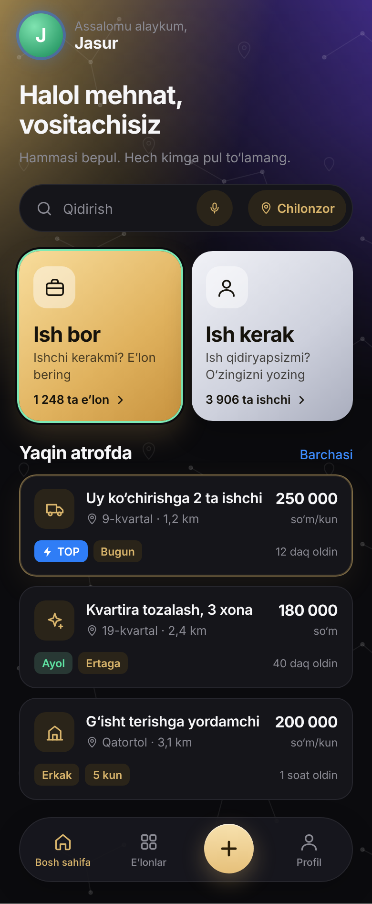 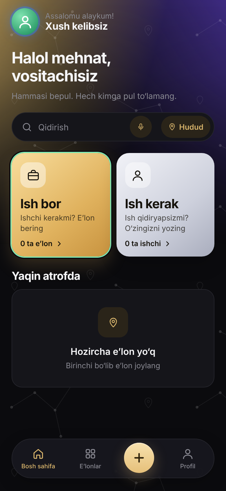

1. Salomlashuv: 46 px yashil avatar (Telegram rasmi, bo‘lmasa ismning birinchi harfi), “Assalomu alaykum,” va Telegram ismi. Telegram ismi bo‘lmasa avatar ichida odam belgisi va “Xush kelibsiz”.
2. Sarlavha (24 px pastda): “Halol mehnat,” / “vositachisiz” — ikki qator, 27 px.
3. Kulrang jumla (8 px pastda): “Hammasi bepul. Hech kimga pul to‘lamang.”
4. Qidiruv qatori (18 px pastda): “Qidirish”, mikrofon, hudud tugmasi (“📍 Chilonzor”, tanlanmagan bo‘lsa “📍 Hudud”).
   - Qidiruv bosilsa: E’lonlar (3.2) ochiladi, qidiruv maydoni faol, klaviatura ochiq.
   - Mikrofon bosilsa: qurilma ovozni matnga o‘gira olsa (Web Speech, `uz-UZ`), gapirilgani qidiruvga yoziladi va 3.2 ochiladi. O‘gira olmasa, mikrofon ko‘rinmaydi (joyi bo‘sh qolmaydi, qidiruv cho‘ziladi).
   - Hudud bosilsa: Hudud (3.11).
5. Ikki katta karta (20 px pastda):
   - “Ish bor” (oltin): portfel, “Ishchi kerakmi? E’lon bering”, pastda “<son> ta e’lon ›” (faol “Ish bor” e’lonlar soni, filtrsiz; bo‘shda “0 ta e’lon”). Bosilsa: 3.2, “Ish bor” bo‘limi.
   - “Ish kerak” (kumush): odam, “Ish qidiryapsizmi? O‘zingizni yozing”, pastda “<son> ta ishchi ›”. Bosilsa: 3.2, “Ish kerak” bo‘limi.
   - Sonlar 1 000 dan katta bo‘lsa bo‘sh joy bilan: “1 248”.
6. “Yaqin atrofda” sarlavhasi, o‘ngda ko‘k “Barchasi” (bosilsa 3.2, “Ish bor”).
7. Yaqin atrofdagi 3 ta “Ish bor” e’loni: tanlangan hudud va masofa ichida, avval TOP, keyin yangisi. Hudud tanlanmagan bo‘lsa — eng yangi 3 tasi. Karta bosilsa 3.3.
   - Bo‘sh: pin belgili karta, “Hozircha e’lon yo‘q”, “Birinchi bo‘lib e’lon joylang”.
8. Pastki menyu, “Bosh sahifa” faol.

### 3.2 E’lonlar — `02-elonlar`

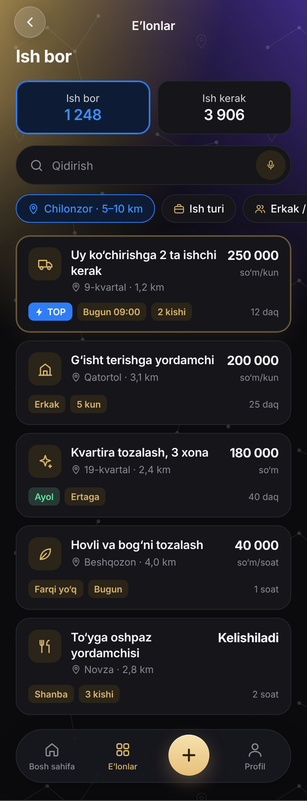 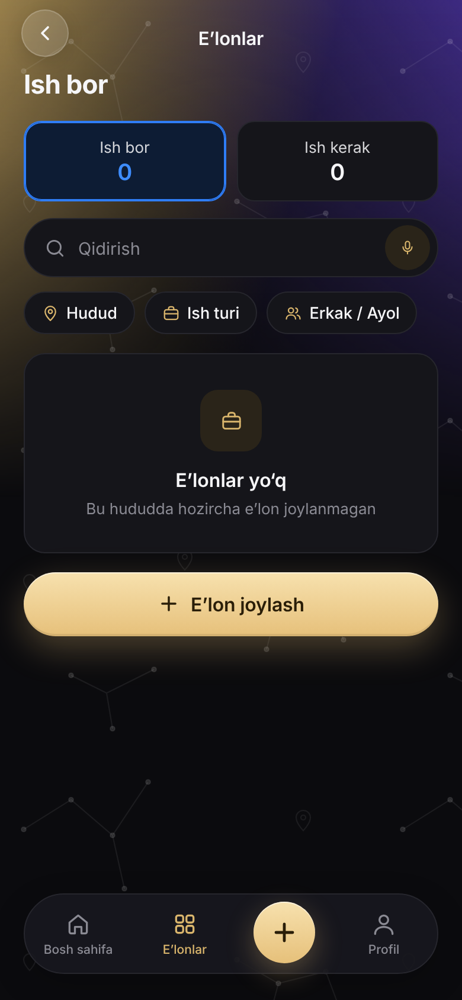

1. Orqaga tugmasi, markazda “E’lonlar”. Katta yorliq: tanlangan bo‘lim (“Ish bor” yoki “Ish kerak”).
2. Ikki tanlov kartasi: “Ish bor” va “Ish kerak”, ostida filtrga mos e’lonlar soni. Bosilsa bo‘lim almashadi, ro‘yxat yangilanadi.
3. Qidiruv: “Qidirish” va mikrofon. Yozilganda 300 ms kutib qidiradi. Qidiruv ish turi nomi, izoh, qo‘shimcha matn va tuman nomi bo‘yicha; lotin va kirill farqsiz (ikkalasi bir xil o‘giriladi), katta-kichik harf farqsiz.
4. Filtr chiplari (bir qatorda, yon tomonga suriladi):
   - “📍 <tuman> · <masofa>” — tanlangan bo‘lsa ko‘k; tanlanmagan bo‘lsa “📍 Hudud”. Bosilsa 3.11.
   - “Ish turi” — bosilsa 27-filtr-ish-turi oynasi. Tanlangan bo‘lsa ko‘k va ichida tanlangan nom(lar): “Tozalash” yoki “Tozalash +2”.
   - “Erkak / Ayol” — bosilsa 28-filtr-jinsi. Tanlangan bo‘lsa ko‘k: “Erkak” yoki “Ayol”.
5. Ro‘yxat: avval filtrga mos TOP e’lonlar (TOP yoqilgan vaqti bo‘yicha, yangisi tepada), keyin qolganlari yangisidan eskisiga. 20 tadan yuklanadi, pastga surilganda keyingi 20 tasi. Tepadan pastga tortilsa yangilanadi.
   - “Ish bor” bo‘limida — ish e’lonlari (bosilsa 3.3); “Ish kerak” bo‘limida — ishchilar (bosilsa 3.4).
   - Ishchi kartasi (`32-elonlar-ish-kerak`): plitkada odam belgisi, sarlavha — ism, ostida pin bilan tuman va masofa, o‘ngda kunlik haq “so‘m/kun”; past qatorda qila oladigan ishlari (birinchisi, ko‘p bo‘lsa “+2”), jinsi (Ayol — yalpiz), “Band” (kulrang, agar band), o‘ngda vaqt.

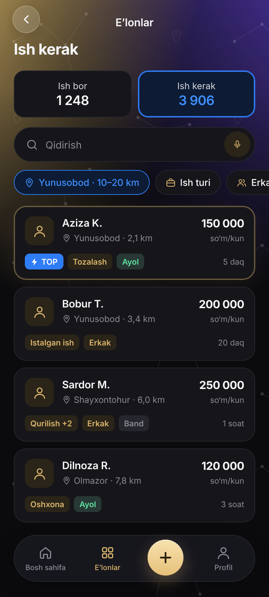
6. Bo‘sh: portfel belgili karta “E’lonlar yo‘q”, “Bu hududda hozircha e’lon joylanmagan” va oltin “+ E’lon joylash” (bosilsa 3.5, ochiq bo‘lgan bo‘limga mos turda).
7. Pastki menyu, “E’lonlar” faol.

### 3.3 “Ish bor” e’loni — `03-ish-bor-tafsilot`

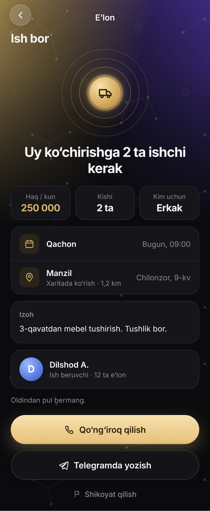

1. Orqaga tugmasi, “E’lon”; katta yorliq “Ish bor”.
2. Halqali oltin belgi, ichida ish turi belgisi.
3. Sarlavha (25 px, markazda, 2 qatorgacha) — e’lon nomi (4.2 dagi qoida bo‘yicha).
4. Uchta ko‘rsatkich: “Haq / kun” yoki “Haq / soat” yoki “Haq” (summa oltin; kelishiladi bo‘lsa “Kelishiladi”), “Kishi” (“2 ta”), “Kim uchun” (“Erkak”, “Ayol”, “Farqi yo‘q”).
5. Karta: “Qachon” (“Bugun, 09:00”, “Ertaga, 08:00”, “12-noyabr, 09:00”); “Manzil” (tuman, ostida “Xaritada ko‘rish · 1,2 km”). Manzil bosilsa xarita ochiladi (Google Maps havolasi `https://maps.google.com/?q=<lat>,<lng>`, `openLink` orqali). Masofa — ko‘rayotgan odamning nuqtasidan; nuqtasi bo‘lmasa masofa yozilmaydi.
6. “Izoh” kartasi: e’lon beruvchi yozgan matn. Izoh bo‘lmasa karta ko‘rinmaydi.
7. E’lon beruvchi kartasi: 44 px ko‘k avatar, Telegram ismi, “Ish beruvchi · <son> ta e’lon”. “✓ Tasdiqlangan” belgisi Nazoratdan berilgan bo‘lsa ism yonida.
8. Kulrang: “Oldindan pul bermang.”
9. Oltin “📞 Qo‘ng‘iroq qilish” — telefon raqamini teradi (`tel:` havola). Raqam yashirilgan bo‘lsa bu tugma yo‘q (19-raqam-yashirin).
10. “Telegramda yozish” — e’lon beruvchining Telegram suhbatini ochadi (`https://t.me/<username>`). Username bo‘lmasa bu tugma yo‘q (shuning uchun 5.2 dagi qoida: username yo‘q odamning raqami doim ko‘rinadi).
11. “🏳 Shikoyat qilish” — 3.10.
12. O‘z e’loni ochilsa — bu oyna emas, 3.12 ochiladi.
13. Yopilgan e’lon ochilsa — 20-elon-yopilgan ko‘rinishi.

### 3.4 “Ish kerak” — ishchi — `04-ish-kerak-tafsilot`

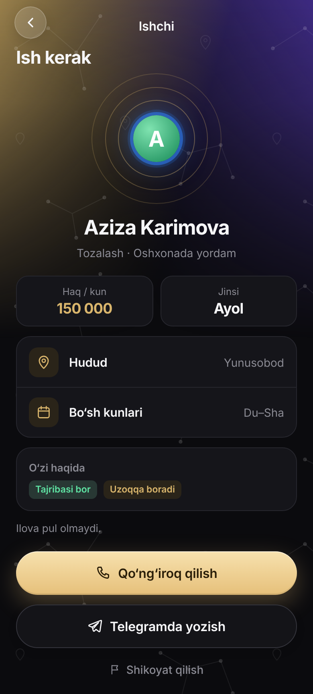

1. Orqaga, “Ishchi”; katta yorliq “Ish kerak”.
2. Halqali yashil belgi: Telegram rasmi yoki ism harfi.
3. Sarlavha — ism. Ostida kulrang qila oladigan ishlari, “ · ” bilan (“Tozalash · Oshxona”); “Istalgan ish” tanlangan bo‘lsa faqat “Istalgan ish”. Band bo‘lsa ostida kulrang “Band” belgisi.
4. Ikki ko‘rsatkich: “Haq / kun” (oltin), “Jinsi”.
5. Karta: “Hudud” (tuman), “Bo‘sh kunlari” (ketma-ket kunlar “Du–Sha”, aralash bo‘lsa “Du, Ch, Ju”, hammasi bo‘lsa “Har kuni”).
6. “O‘zi haqida” kartasi: belgilar — “Tajribasi bor” (yalpiz), “Ish qurollari bor”, “Uzoqqa boradi”, “Har kuni” (oltin); “Qo‘shimcha” matni va ovozi bo‘lsa ularning ostida. Hech narsa bo‘lmasa karta yo‘q.
7. Kulrang: “Ilova pul olmaydi.”
8. Oltin “Qo‘ng‘iroq qilish”, ikkinchi darajali “Telegramda yozish”, havola “Shikoyat qilish” — 3.3 dagi qoidalar bilan.

### 3.5 E’lon joylash — “Ish bor” — `05-joylash-ish-bor`

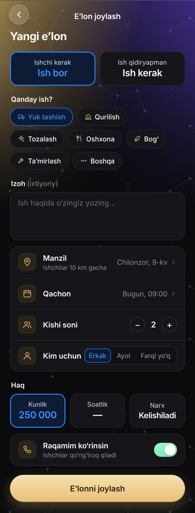 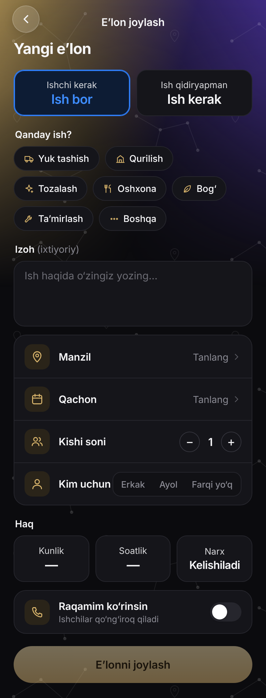

Pastki menyudagi “+” bosilganda ochiladi. Oxirgi marta qaysi tur tanlangan bo‘lsa, o‘sha ochiladi (birinchi marta “Ish bor”).

1. Orqaga, “E’lon joylash”; katta yorliq “Yangi e’lon”.
2. Tanlov: “Ishchi kerak / Ish bor” (tanlangan) va “Ish qidiryapman / Ish kerak” (bosilsa 3.6; kiritilgan narsalar yo‘qolmaydi).
3. “Qanday ish?” — chiplar: Yuk tashish, Qurilish, Tozalash, Oshxona, Bog‘, Ta’mirlash, Boshqa. **Bittasi** tanlanadi. Ro‘yxat Nazoratdagi “Ish turlari”dan keladi.
4. “Izoh (ixtiyoriy)” — matn maydoni, taklif “Ish haqida o‘zingiz yozing…”, 300 belgigacha. Tayyor variantlar yo‘q.
5. Karta:
   - “Manzil” — “Tanlang ›”; tanlangach “<tuman>” va ostida “Ishchilar <masofa> gacha” (masalan “Ishchilar 10 km gacha”; “35 km dan uzoq” bo‘lsa “Ishchilar istalgan joydan”). Bosilsa 3.11.
   - “Qachon” — “Tanlang ›”; tanlangach “Bugun, 09:00”. Bosilsa 16-qachon.
   - “Kishi soni” — sanagich, boshida 1.
   - “Kim uchun” — Erkak | Ayol | Farqi yo‘q. Boshida hech biri tanlanmagan.
6. “Haq” — uchta tanlov: “Kunlik”, “Soatlik” (bosilsa 17-haq-kiritish; kiritilmaguncha “—”), “Narx: Kelishiladi” (summa so‘ralmaydi).
7. “Raqamim ko‘rinsin” almashtirgich, ostida “Ishchilar qo‘ng‘iroq qiladi”. Boshida o‘chiq. Yoqilganda telefon raqami hali ulanmagan bo‘lsa, Telegram’ning o‘z “Raqamni ulashish” oynasi chiqadi (`requestContact`). Rad etilsa almashtirgich o‘chiq qoladi. Telegram username’i yo‘q odamda almashtirgich yoqilgan va o‘chirilmaydi, ostida “Telegramda username yo‘q, shuning uchun raqam kerak”.
8. Oltin “E’lonni joylash” — ish turi, manzil, qachon, kim uchun va haq (Kunlik/Soatlik bo‘lsa summa) tanlanmaguncha xira. Bosilsa: tugmada aylanuvchi belgi → e’lon saqlanadi → 3.7. Izohda shubhali so‘z bo‘lsa ham 3.7 ko‘rinadi, lekin e’lon Navbatga tushadi va tasdiqlangach chiqadi (5.5).
9. Forma yarim to‘ldirilib chiqib ketilsa, kiritilgani shu telefonda saqlanib turadi va keyingi safar qaytadi.

### 3.6 E’lon joylash — “Ish kerak” — `06-joylash-ish-kerak`

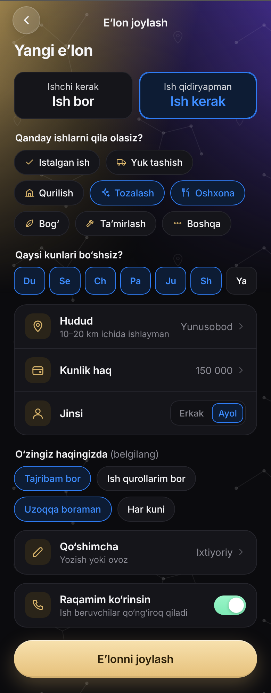 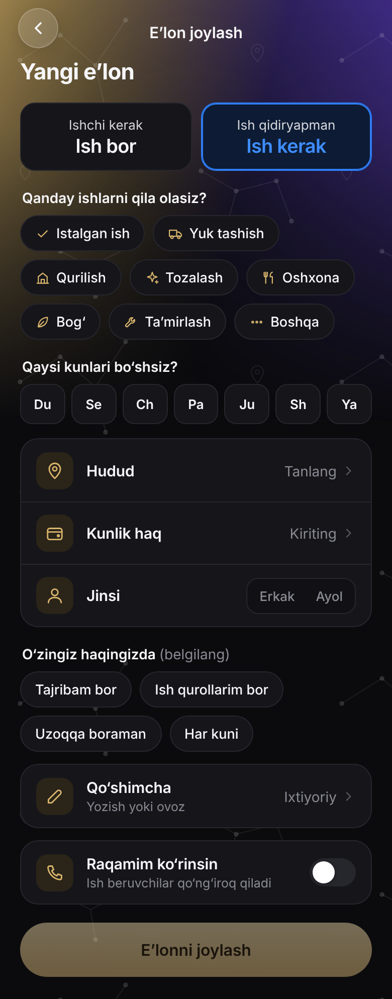

1. Tepa qism 3.5 dagidek, ikkinchi tanlov kartasi tanlangan.
2. “Qanday ishlarni qila olasiz?” — chiplar: “✓ Istalgan ish” (birinchi), Yuk tashish, Qurilish, Tozalash, Oshxona, Bog‘, Ta’mirlash, Boshqa. **Bir nechtasi** tanlanadi. “Istalgan ish” bosilsa boshqalari o‘chadi; boshqasi bosilsa “Istalgan ish” o‘chadi. “Istalgan ish” — har qanday ish turi filtrida chiqadi (raznorabochiy).
3. “Qaysi kunlari bo‘shsiz?” — 7 kun, bir nechtasi. Boshida hammasi o‘chiq. Hech biri tanlanmasa “Har kuni” deb hisoblanadi.
4. Karta:
   - “Hudud” — “Tanlang ›”; tanlangach “<tuman>”, ostida “<masofa> ichida ishlayman” (“35 km dan uzoq” → “Uzoqqa ham boraman”). Bosilsa 3.11.
   - “Kunlik haq” — “Kiriting ›”; bosilsa 17-haq-kiritish; kiritilgach “150 000”.
   - “Jinsi” — Erkak | Ayol.
5. “O‘zingiz haqingizda (belgilang)” — chiplar: Tajribam bor, Ish qurollarim bor, Uzoqqa boraman, Har kuni. Ixtiyoriy, bir nechtasi.
6. “Qo‘shimcha” qatori — “Ixtiyoriy ›”, ostida “Yozish yoki ovoz”. Bosilsa 18-qoshimcha. To‘ldirilgach qiymat “Yozildi” yoki “Ovoz 0:24”.
7. “Raqamim ko‘rinsin”, ostida “Ish beruvchilar qo‘ng‘iroq qiladi” — 3.5 dagi qoidalar.
8. Oltin “E’lonni joylash” — ish turi, hudud, kunlik haq va jinsi tanlanmaguncha xira.
9. Ism va rasm so‘ralmaydi — Telegramdan olinadi. Bir odamda bitta faol “Ish kerak” e’loni bo‘ladi: ikkinchisini joylasa, eskisi yangisi bilan almashadi (TOP muddati saqlanadi).

### 3.7 E’lon joylandi — `07-joylandi`

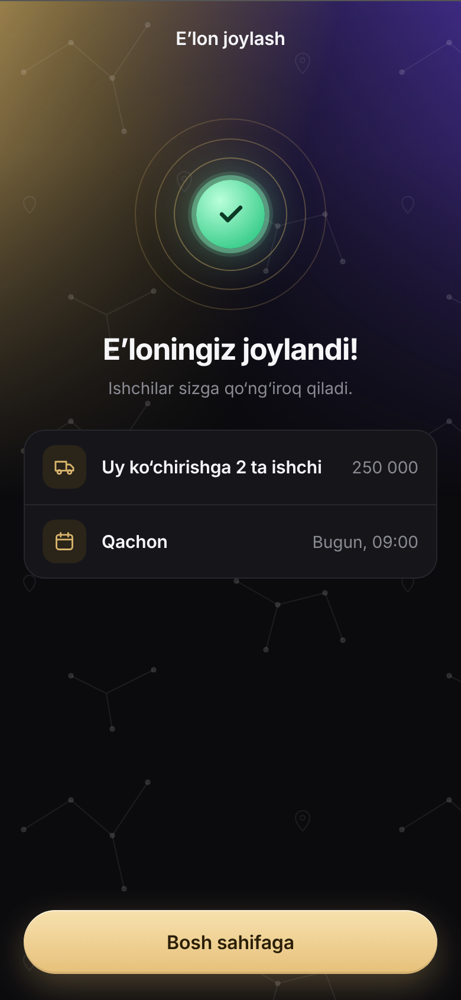

1. Markazda “E’lon joylash”, orqaga tugmasi yo‘q.
2. Halqali yalpiz belgi, ichida ✓. Ochilganda Telegram tebranishi `notificationOccurred('success')`.
3. “E’loningiz joylandi!”, ostida “Ishchilar sizga qo‘ng‘iroq qiladi.” (“Ish kerak” da — “Ish beruvchilar sizga qo‘ng‘iroq qiladi.”).
4. Karta: e’lon nomi va haqi; “Qachon” (“Ish kerak” da “Bo‘sh kunlari”).
5. Oltin “Bosh sahifaga” → 3.1. TOP taklifi yo‘q.

### 3.8 Profil — `08-profil`

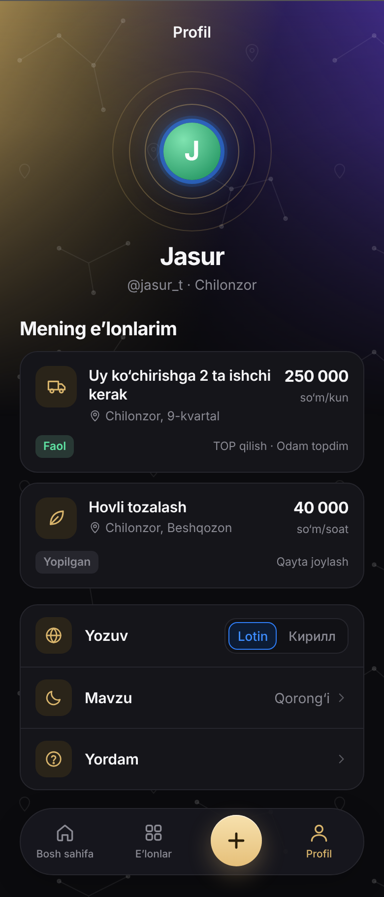 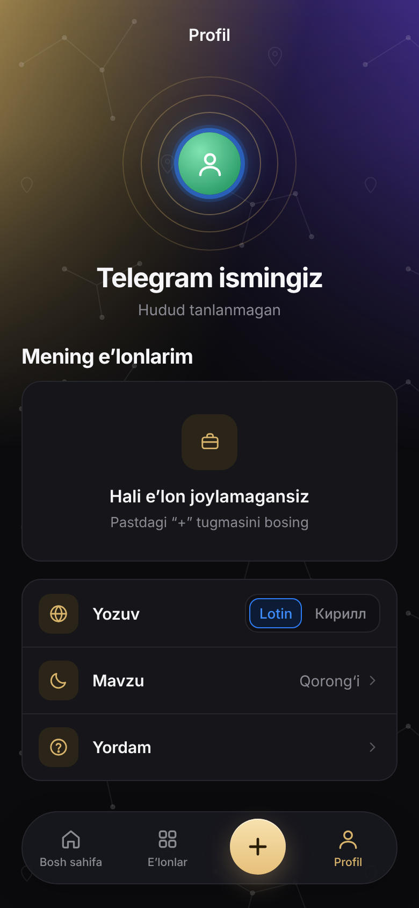

1. Markazda “Profil”, orqaga yo‘q.
2. Halqali yashil belgi: Telegram rasmi yoki harf (bo‘shda odam belgisi).
3. Ism (Telegramdan), ostida “@username · <tuman>”; username yo‘q bo‘lsa faqat tuman; tuman yo‘q bo‘lsa “Hudud tanlanmagan”.
4. “Mening e’lonlarim” — o‘z e’lonlari, yangisi tepada:
   - Faol “Ish bor”: yalpiz “Faol”, o‘ngda “TOP qilish · Odam topdim”. “TOP qilish” bosilsa 3.9; “Odam topdim” bosilsa darhol yopiladi (5.3). Kartaning boshqa joyi bosilsa 3.12.
   - Faol “Ish kerak”: “TOP qilish · Band”; “Band” bosilsa band holati yoqiladi/o‘chadi. Karta bosilsa 3.13.
   - TOP yoqiq e’lon: ko‘k “⚡ TOP” belgisi ham bor, “TOP qilish” o‘rnida “TOPni uzaytirish”.
   - Navbatda turgan e’lon: kulrang “Tekshirilmoqda”.
   - Yopilgan: kulrang “Yopilgan”, o‘ngda “Qayta joylash” (bosilsa e’lon yana faol bo‘ladi, sanasi bugungi bo‘ladi; “Ish bor” da “Qachon” o‘tib ketgan bo‘lsa avval 16-qachon ochiladi).
   - Bo‘sh: “Hali e’lon joylamagansiz”, “Pastdagi “+” tugmasini bosing”.
5. Sozlamalar kartasi:
   - “Yozuv” — Lotin | Кирилл. Bosilganda butun ilova darhol almashadi, tanlov saqlanadi. Boshida Telegram tili “ru”, “uk”, “be”, “kk”, “ky”, “tg” bo‘lsa yoki qurilmada kirill tanlangan bo‘lsa — Кирилл, aks holda Lotin.
   - “Mavzu” — “Qorong‘i ›” / “Yorug‘ ›” / “Telegramdagidek ›”; bosilsa 24-mavzu.
   - “Yordam ›” — 25-yordam.
6. Faqat Jasurning raqami bilan kirilganda, sozlamalar kartasidan keyin eng pastda alohida karta: “🛡 Nazorat bo‘limi”, izohi “Faqat sizga ko‘rinadi” (Nazorat A rasmidagi qator). Boshqalarga bu karta umuman yuborilmaydi.
7. Pastki menyu, “Profil” faol.

### 3.9 TOP — `09-tarif`

 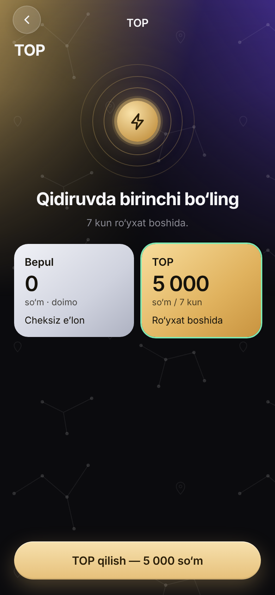

1. Orqaga, “TOP”; katta yorliq “TOP”.
2. Halqali oltin belgi, chaqmoq.
3. “Qidiruvda birinchi bo‘ling”, ostida “7 kun ro‘yxat boshida.” (kun soni Nazoratdagi sozlamadan).
4. Ikki karta: “Bepul” (kumush) — “0”, “so‘m · doimo”, “Cheksiz e’lon”; “TOP” (oltin, yalpiz halqa) — “5 000”, “so‘m / 7 kun”, “Ro‘yxat boshida”.
5. Oltin “TOP qilish — 5 000 so‘m” → 3.14. TOP yoqiq bo‘lsa 23-top-uzaytirish ko‘rinishi.
6. “Kerak emas” tugmasi yo‘q. Pul qayerga ketishi yozilmaydi. Boshqa joyda TOP reklamasi yo‘q.
7. To‘lov ulanmagan bo‘lsa (Multicard kalitlari yo‘q yoki Nazoratda to‘lov o‘chirilgan) — “TOP qilish” havolalari ilovada umuman ko‘rinmaydi.

### 3.10 Shikoyat — `10-shikoyat`

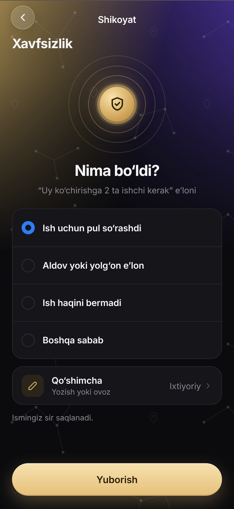 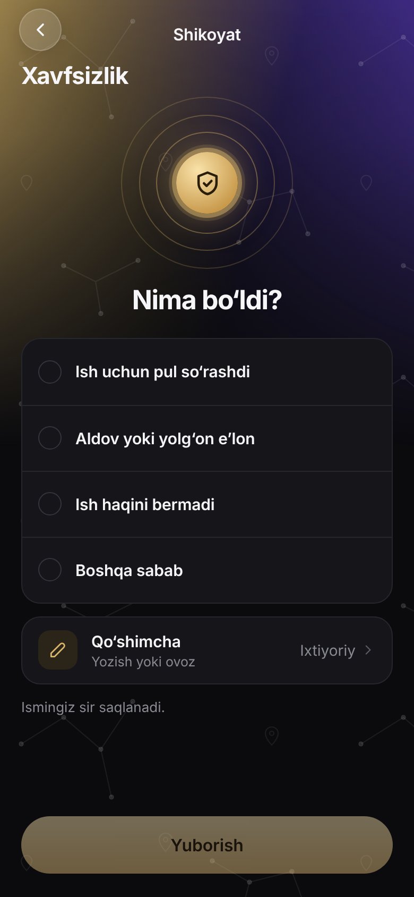

1. Orqaga, “Shikoyat”; katta yorliq “Xavfsizlik”.
2. Halqali oltin qalqon.
3. “Nima bo‘ldi?”, ostida ““<e’lon nomi>” e’loni” (ishchi haqida — “<ism> haqida”).
4. Radio, bittasi: “Ish uchun pul so‘rashdi”, “Aldov yoki yolg‘on e’lon”, “Ish haqini bermadi”, “Boshqa sabab”. Boshida hech biri tanlanmagan.
5. “Qo‘shimcha” (ixtiyoriy, 18-qoshimcha).
6. Kulrang: “Ismingiz sir saqlanadi.”
7. Oltin “Yuborish” — sabab tanlanmaguncha xira. Bosilsa → 26-shikoyat-yuborildi. Bir odam bir e’longa bir marta shikoyat qila oladi; ikkinchi marta ochsa tugma o‘rnida kulrang “Shikoyatingiz qabul qilingan”.

### 3.11 Hudud — `11-hudud-tanlash`

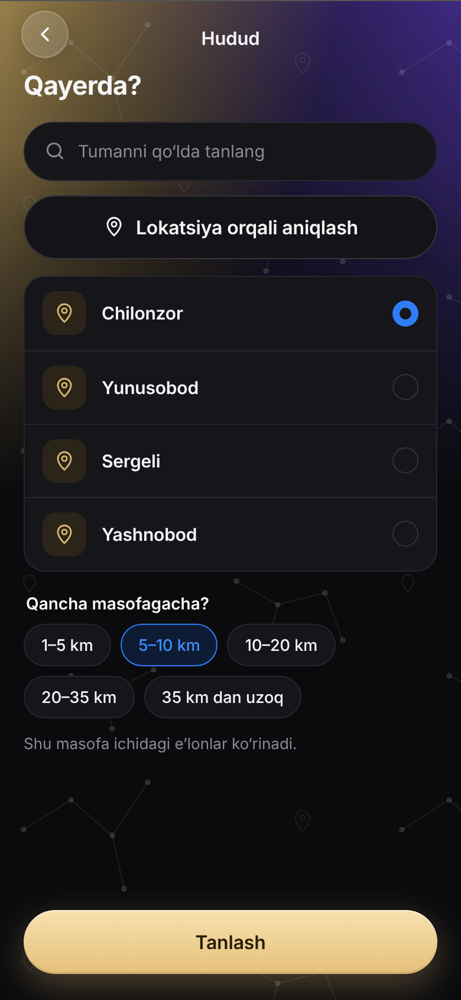 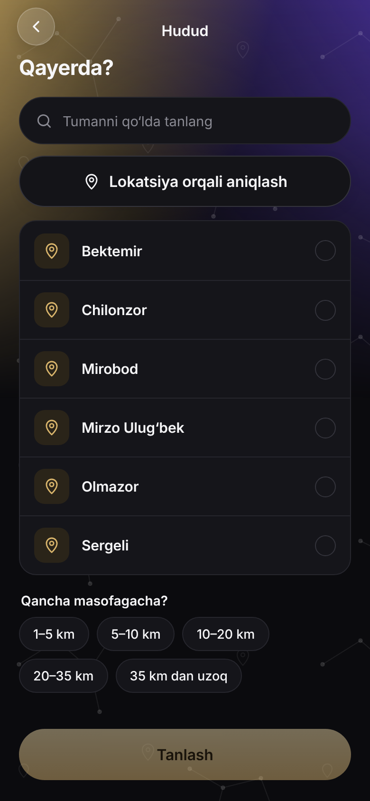

1. Orqaga, “Hudud”; katta yorliq “Qayerda?”.
2. Qidiruv maydoni “Tumanni qo‘lda tanlang” — yozilganda ro‘yxat qisqaradi.
3. Ikkinchi darajali “📍 Lokatsiya orqali aniqlash” — Telegram’ning joylashuv ruxsati (`LocationManager`, bo‘lmasa brauzer `geolocation`). Nuqta olinadi, eng yaqin tuman o‘zi tanlanadi va aniq nuqta saqlanadi (masofa shu nuqtadan hisoblanadi). Rad etilsa kulrang jumla: “Joylashuvga ruxsat berilmadi. Tumanni qo‘lda tanlang.”
4. Tumanlar kartasi: pin plitka, nom, radio. Ro‘yxat Nazoratdagi “Hududlar”dan (boshida Toshkent shahrining 12 tumani, 8-bo‘lim).
5. “Qancha masofagacha?” — 1–5 km, 5–10 km, 10–20 km, 20–35 km, 35 km dan uzoq. Bittasi. Boshida “5–10 km”.
6. Kulrang: “Shu masofa ichidagi e’lonlar ko‘rinadi.”
7. Oltin “Tanlash” — tuman (yoki lokatsiya) va masofa tanlanmaguncha xira. Bosilsa oyna yopiladi va tanlov chaqirgan joyga yoziladi:
   - Bosh sahifa yoki E’lonlar filtridan ochilgan bo‘lsa — qidiruv hududi (saqlanadi).
   - 3.5 “Manzil” dan — e’lon manzili va “ishchilar shu masofagacha”. Aniq mo‘ljal (kvartal, uy) uchun alohida maydon yo‘q: odam uni “Izoh”ga yozadi. Manzil qatorida tuman nomi turadi.
   - 3.6 “Hudud” dan — ishchi hududi va “shu masofada ishlayman”.

### 3.12 Mening e’lonim — “Ish bor” — `12-mening-elonim-ish-bor`

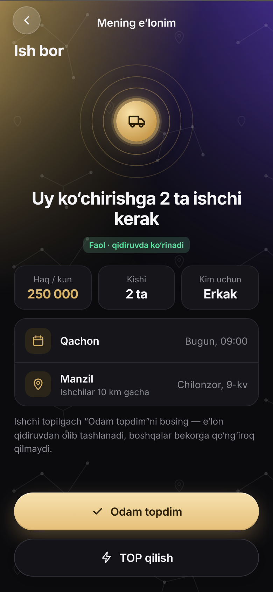

1. Orqaga, “Mening e’lonim”; katta yorliq “Ish bor”.
2. Halqali oltin belgi, e’lon nomi.
3. Holat belgisi: yalpiz “Faol · qidiruvda ko‘rinadi”; TOP bo‘lsa yonida ko‘k “⚡ TOP · <n> kun”; navbatda bo‘lsa kulrang “Tekshirilmoqda”.
4. Uchta ko‘rsatkich, “Qachon” va “Manzil” (ostida “Ishchilar <masofa> gacha”).
5. Kulrang: “Ishchi topilgach “Odam topdim”ni bosing — e’lon qidiruvdan olib tashlanadi, boshqalar bekorga qo‘ng‘iroq qilmaydi.”
6. Oltin “✓ Odam topdim” → e’lon yopiladi, 3.8 ga qaytadi, karta “Yopilgan”.
7. Ikkinchi darajali “⚡ TOP qilish” → 3.9 (TOP yoqiq bo‘lsa “⚡ TOPni uzaytirish”).
8. Tahrirlash tugmasi yo‘q (dizaynda yo‘q). O‘zgartirish kerak bo‘lsa, odam “Odam topdim” bilan yopib, yangisini joylaydi.

### 3.13 Mening e’lonim — “Ish kerak” — `13-mening-elonim-ish-kerak`

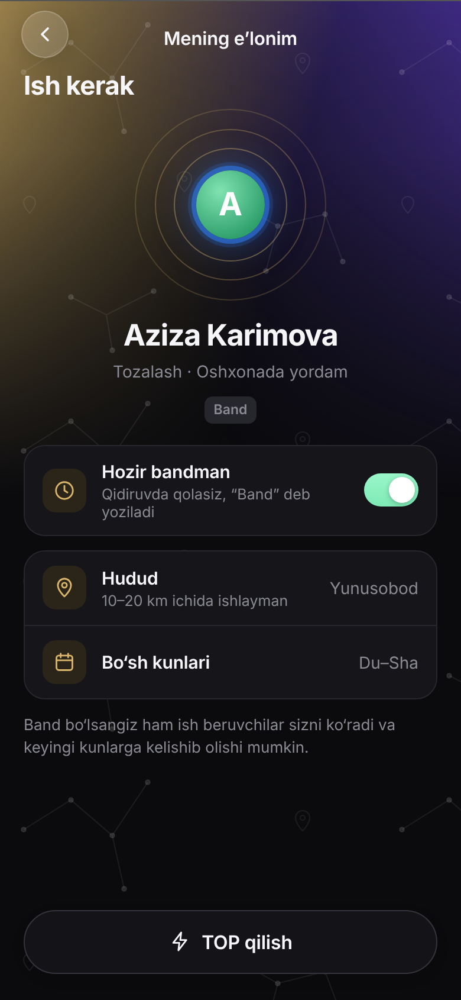

1. Orqaga, “Mening e’lonim”; katta yorliq “Ish kerak”.
2. Halqali yashil belgi, ism, ostida ishlari.
3. Holat: kulrang “Band” (band bo‘lmasa yo‘q).
4. Karta: “Hozir bandman”, ostida “Qidiruvda qolasiz, “Band” deb yoziladi”, almashtirgich (yoqilsa yalpiz).
5. Karta: “Hudud” (ostida masofa), “Bo‘sh kunlari”.
6. Kulrang: “Band bo‘lsangiz ham ish beruvchilar sizni ko‘radi va keyingi kunlarga kelishib olishi mumkin.”
7. Ikkinchi darajali “⚡ TOP qilish”.
8. Tahrirlash tugmasi yo‘q. Ishchi “+” orqali qayta joylasa, yangi ma’lumot eski e’lon o‘rniga yoziladi (bir odamda bitta “Ish kerak”). 30 kun hech narsa o‘zgarmasa bot so‘raydi: “Hali ish qidiryapsizmi?” — “Ha” bo‘lsa yana 30 kun, “Yo‘q” yoki 3 kunda javob bo‘lmasa e’lon yopiladi.

### 3.14 To‘lov — `14-tolov`

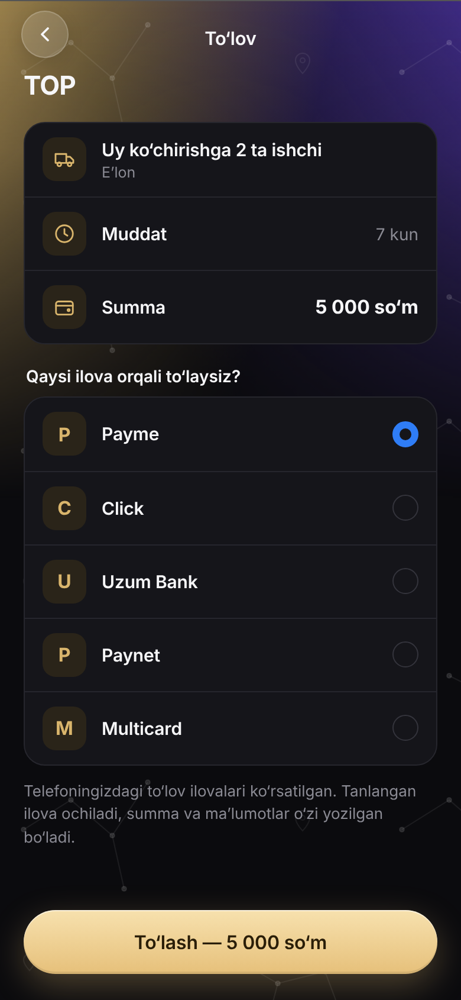

1. Orqaga, “To‘lov”; katta yorliq “TOP”.
2. Xulosa: e’lon nomi (izoh “E’lon”), “Muddat — 7 kun”, “Summa — 5 000 so‘m” (qalin).
3. “Qaysi ilova orqali to‘laysiz?” — qatorlar: harfli plitka (P, C, U, P, M), nom, radio: Payme, Click, Uzum Bank, Paynet, Multicard. Ro‘yxat serverdan keladi (Multicard do‘koningizda yoqilgan to‘lov turlari; 7-bo‘lim). Telegram ichidan telefondagi o‘rnatilgan ilovalarni aniqlab bo‘lmaydi, shuning uchun hammasi ko‘rsatiladi. Oxirgi ishlatilgani oldindan tanlangan; birinchi marta Payme.
4. Kulrang: “Telefoningizdagi to‘lov ilovalari ko‘rsatilgan. Tanlangan ilova ochiladi, summa va ma’lumotlar o‘zi yozilgan bo‘ladi.”
5. Oltin “To‘lash — 5 000 so‘m” → server to‘lov yaratadi (7.3) → tanlangan ilova summa bilan ochiladi → bu oyna 21-tolov-kutilmoqda holatiga o‘tadi.

### 3.15 To‘lov qabul qilindi — `15-tolov-qabul`

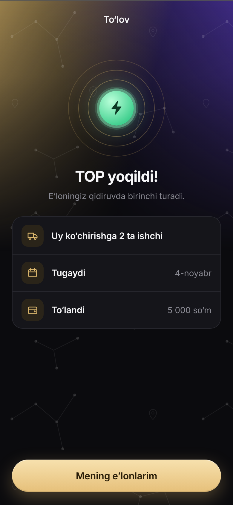

1. Markazda “To‘lov”, orqaga yo‘q.
2. Halqali yalpiz belgi, chaqmoq; `notificationOccurred('success')`.
3. “TOP yoqildi!”, ostida “E’loningiz qidiruvda birinchi turadi.”
4. Karta: e’lon nomi, “Tugaydi — <sana>” (“4-noyabr”), “To‘landi — 5 000 so‘m”.
5. Oltin “Mening e’lonlarim” → 3.8.

### 3.16 Qachon — `16-qachon` (pastdan chiqadigan oyna)

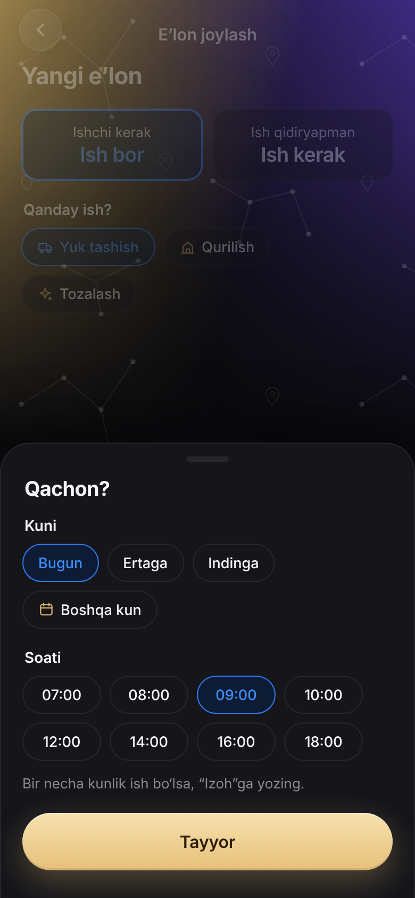

3.5 dagi “Qachon” qatoridan ochiladi. Orqada forma xira.
1. Sarlavha “Qachon?”.
2. “Kuni” — chiplar: Bugun, Ertaga, Indinga, “📅 Boshqa kun”. “Boshqa kun” bosilsa telefonning o‘z sana tanlagichi ochiladi (bugundan 60 kun ichida); tanlangach chip “12-noyabr” bo‘ladi.
3. “Soati” — 07:00, 08:00, 09:00, 10:00, 12:00, 14:00, 16:00, 18:00. Bittasi. “Bugun” tanlangan bo‘lsa o‘tib ketgan soatlar xira va bosilmaydi.
4. Kulrang: “Bir necha kunlik ish bo‘lsa, “Izoh”ga yozing.”
5. Oltin “Tayyor” — kun va soat tanlanmaguncha xira. Bosilsa oyna yopiladi, qatorda “Bugun, 09:00”.

### 3.17 Haq kiritish — `17-haq-kiritish` (pastdan)

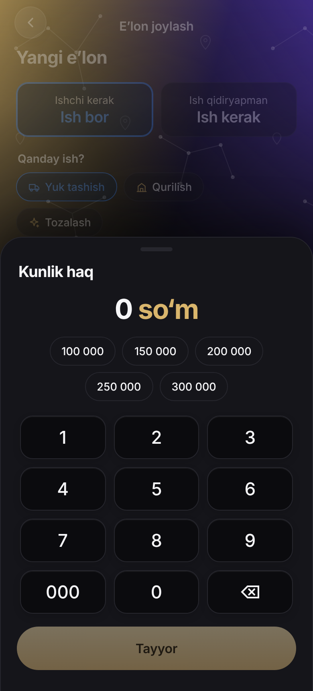

3.5 dagi “Kunlik”/“Soatlik” va 3.6 dagi “Kunlik haq” dan ochiladi.
1. Sarlavha: “Kunlik haq” yoki “Soatlik haq”.
2. Katta summa “0 so‘m” (34 px; “so‘m” oltin). Raqamlar uch xonadan bo‘sh joy bilan.
3. Tez tanlov chiplari: kunlik — 100 000, 150 000, 200 000, 250 000, 300 000; soatlik — 20 000, 30 000, 40 000, 50 000, 60 000. Bosilsa summa shu bo‘ladi.
4. O‘z raqam tugmalari: 1–9, “000”, 0, ⌫ (telefon klaviaturasi ochilmaydi).
5. Oltin “Tayyor” — summa 0 bo‘lsa xira. Eng ko‘pi 10 000 000 so‘m.

### 3.18 Qo‘shimcha / ovoz — `18-qoshimcha` (pastdan)

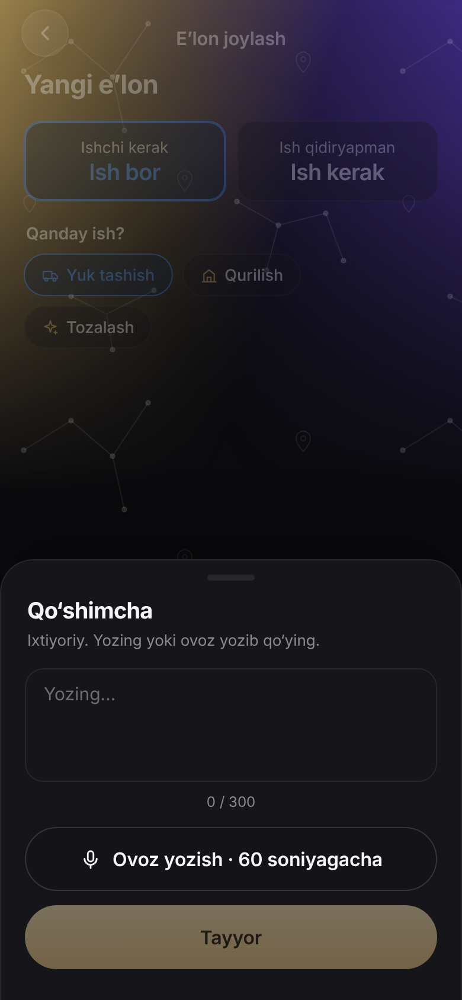

3.6 va 3.10 dagi “Qo‘shimcha” qatoridan ochiladi.
1. “Qo‘shimcha”, ostida “Ixtiyoriy. Yozing yoki ovoz yozib qo‘ying.”
2. Matn maydoni “Yozing…”, ostida “0 / 300”.
3. Ikkinchi darajali “🎙 Ovoz yozish · 60 soniyagacha”. Bosilsa mikrofon ruxsati so‘raladi va yozish boshlanadi: tugma “⏹ To‘xtatish · 0:12” bo‘ladi, 60 soniyada o‘zi to‘xtaydi. Yozilgach o‘rnida ovoz qatori: ▶ tinglash, uzunligi, “✕” o‘chirish. Mikrofon ishlamaydigan qurilmada bu tugma ko‘rinmaydi.
4. Oltin “Tayyor” — matn ham ovoz ham bo‘lmasa xira.

### 3.19 Raqami yashirilgan e’lon — `19-raqam-yashirin`

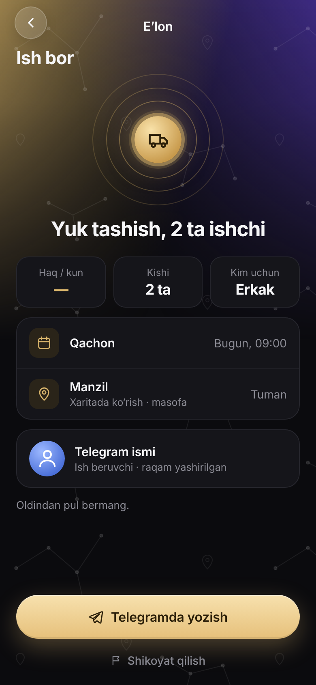

3.3 bilan bir xil, faqat: e’lon beruvchi kartasida “Ish beruvchi · raqam yashirilgan”; “Qo‘ng‘iroq qilish” yo‘q; asosiy oltin tugma “Telegramda yozish”. Narx kelishiladigan bo‘lsa ko‘rsatkichda “—” emas “Kelishiladi”.

### 3.20 Yopilgan e’lon — `20-elon-yopilgan`

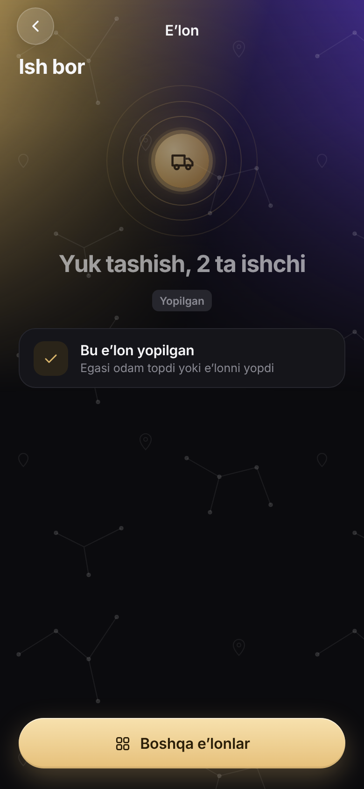

Ro‘yxat ochiq turganda e’lon yopilgan bo‘lsa yoki eski havola orqali kirilsa.
1. Belgi va sarlavha xira (55–60%), ostida kulrang “Yopilgan”.
2. Karta: “✓ Bu e’lon yopilgan”, “Egasi odam topdi yoki e’lonni yopdi”.
3. Oltin “Boshqa e’lonlar” → 3.2. Qo‘ng‘iroq va Telegram tugmalari yo‘q.

### 3.21 To‘lov kutilmoqda — `21-tolov-kutilmoqda`

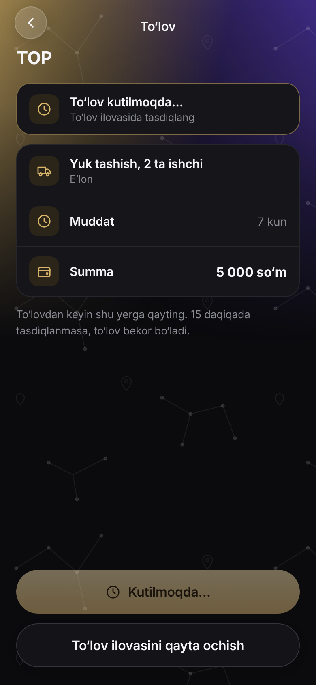

1. Tepada oltin chegarali karta: soat belgisi, “To‘lov kutilmoqda…”, “To‘lov ilovasida tasdiqlang”.
2. Xulosa kartasi (3.14 dagidek).
3. Kulrang: “To‘lovdan keyin shu yerga qayting. 15 daqiqada tasdiqlanmasa, to‘lov bekor bo‘ladi.”
4. Xira oltin “⏱ Kutilmoqda…” (bosilmaydi).
5. Ikkinchi darajali “To‘lov ilovasini qayta ochish” — o‘sha havolani yana ochadi.
6. Ilova har 3 soniyada serverdan holatni so‘raydi. Tasdiq kelsa → 3.15; bekor yoki 15 daqiqa o‘tsa → 3.22.

### 3.22 To‘lov o‘tmadi — `22-tolov-otmadi`

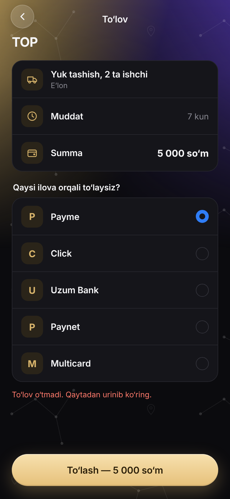

3.14 ko‘rinishi, ilovalar ro‘yxati ostida qizil jumla “To‘lov o‘tmadi. Qaytadan urinib ko‘ring.”, “To‘lash — 5 000 so‘m” yana faol.

### 3.23 TOPni uzaytirish — `23-top-uzaytirish`

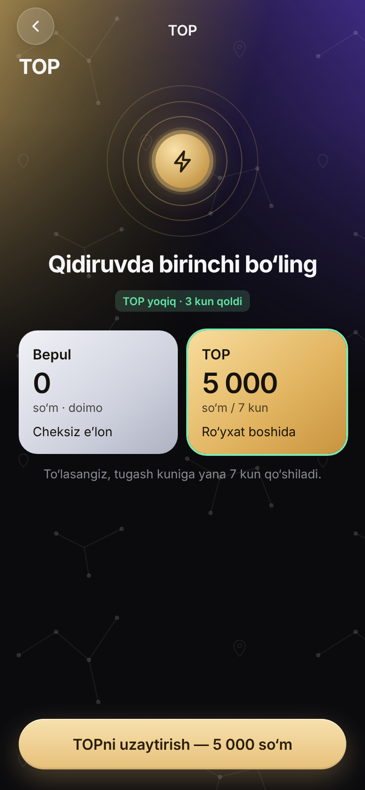

TOP yoqiq e’lon uchun 3.9 ko‘rinishi: sarlavha ostida yalpiz “TOP yoqiq · <n> kun qoldi” (24 soatdan kam bo‘lsa “bugun tugaydi”), kartalar ostida “To‘lasangiz, tugash kuniga yana 7 kun qo‘shiladi.”, oltin “TOPni uzaytirish — 5 000 so‘m” → 3.14.

### 3.24 Mavzu — `24-mavzu` (pastdan)

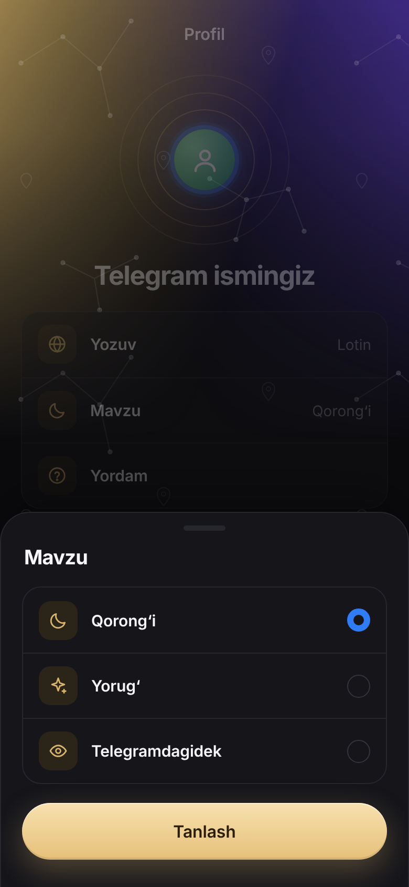

Radio: “Qorong‘i”, “Yorug‘”, “Telegramdagidek” (Telegram mavzusiga ergashadi, `colorScheme`). Boshida “Telegramdagidek”. Oltin “Tanlash” — darhol almashtiradi va saqlaydi. Telegram sarlavha va pastki chiziq ranglari ham `setHeaderColor`/`setBackgroundColor`/`setBottomBarColor` bilan `--bg` ga tenglanadi.

### 3.25 Yordam — `25-yordam`

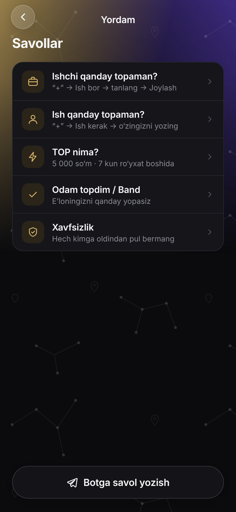

1. Orqaga, “Yordam”; katta yorliq “Savollar”.
2. Qatorlar (bosilsa ostida javob ochiladi, yana bosilsa yopiladi):
   - “Ishchi qanday topaman?” — “Pastdagi “+” ni bosing, “Ish bor”ni tanlang, ish turini, manzil va vaqtni belgilang, “E’lonni joylash”ni bosing. Ishchilar o‘zi qo‘ng‘iroq qiladi.”
   - “Ish qanday topaman?” — “+” → “Ish kerak” → qila oladigan ishlaringiz, kunlaringiz va hududingiz → “E’lonni joylash”. Yoki “E’lonlar”dan ish tanlab qo‘ng‘iroq qiling.”
   - “TOP nima?” — “5 000 so‘m to‘lasangiz, e’loningiz 7 kun ro‘yxat boshida turadi. Faqat filtrga mos ro‘yxatda. E’lon joylash har doim bepul.”
   - “Odam topdim / Band” — ““Odam topdim” — ishchi topilgach e’lonni yopadi. “Band” — ishchi hozir band ekanini bildiradi, lekin ro‘yxatda qoladi.”
   - “Xavfsizlik” — “Hech kimga oldindan pul bermang. Ilova hech qachon pul so‘ramaydi (faqat siz o‘zingiz xohlab TOP qilsangiz). Pul so‘rashsa — “Shikoyat qilish”ni bosing.”
3. Ikkinchi darajali “Botga savol yozish” — bot suhbatini ochadi; u yerda yozilgan har bir xabar Nazorat → Navbat → “Savol” ga tushadi.

### 3.26 Shikoyat yuborildi — `26-shikoyat-yuborildi`

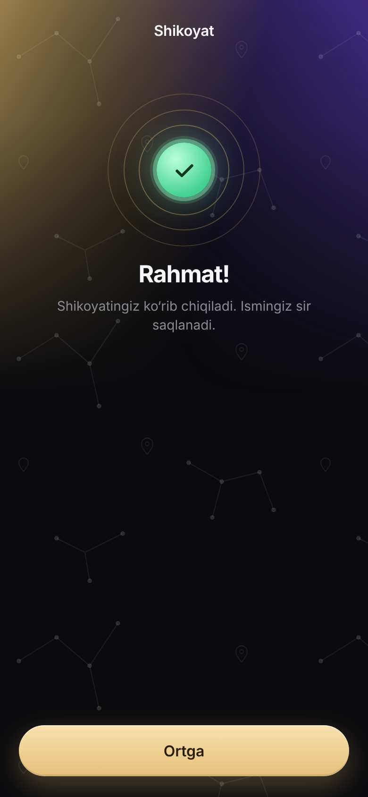

Yalpiz ✓, “Rahmat!”, “Shikoyatingiz ko‘rib chiqiladi. Ismingiz sir saqlanadi.”, oltin “Ortga” → shikoyat qilingan e’lon oynasiga.

### 3.27 Ish turi filtri — `27-filtr-ish-turi` (pastdan)

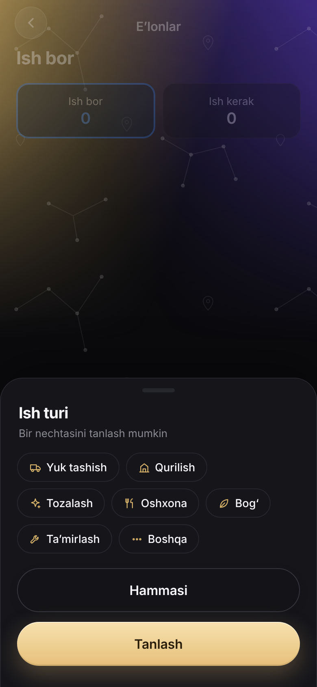

“Ish turi”, “Bir nechtasini tanlash mumkin”, ish turlari chiplari (belgilari bilan), ikkinchi darajali “Hammasi” (tanlovni tozalaydi), oltin “Tanlash”. “Ish kerak” bo‘limida “Istalgan ish” ni tanlagan ishchilar har qanday tanlovda chiqadi.

### 3.28 Jinsi filtri — `28-filtr-jinsi` (pastdan)

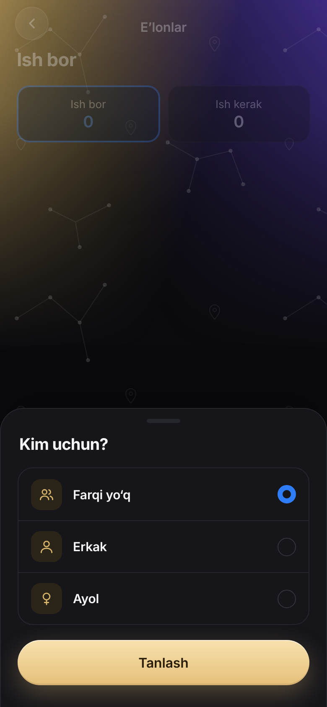

“Kim uchun?”, radio: “Farqi yo‘q” (boshida), “Erkak”, “Ayol”, oltin “Tanlash”. “Ish bor” da “Erkak” tanlansa “Erkak” va “Farqi yo‘q” e’lonlar chiqadi; “Ish kerak” da shu jinsdagi ishchilar.

### 3.29 Hisob cheklangan — `29-cheklangan`

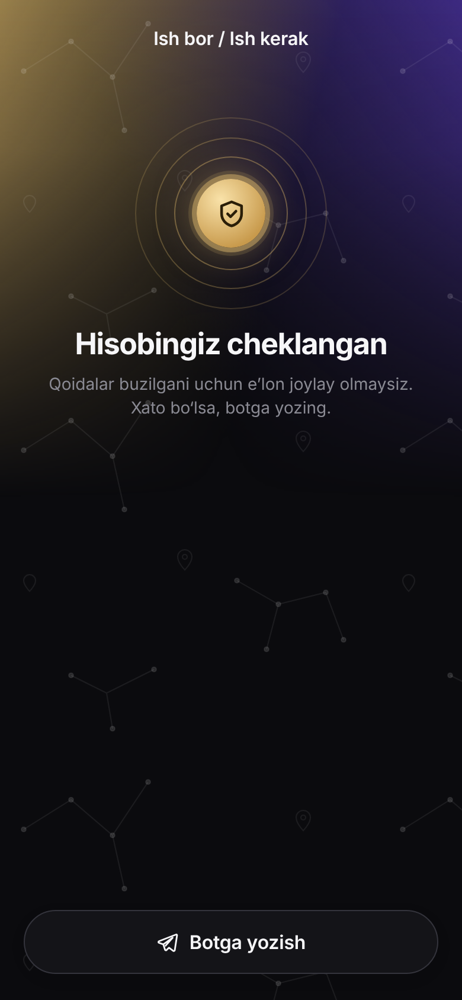

Nazoratdan bloklangan odam “+” yoki “E’lonni joylash”ni bossa ko‘radi. E’lonlarni ko‘rishi va qo‘ng‘iroq qilishi mumkin, lekin joylay olmaydi, shikoyat qila olmaydi, TOP qila olmaydi. Uning e’lonlari ro‘yxatdan olinadi. “Botga yozish” — bot suhbati.

### 3.30 Texnik ishlar — `30-texnik-ishlar`

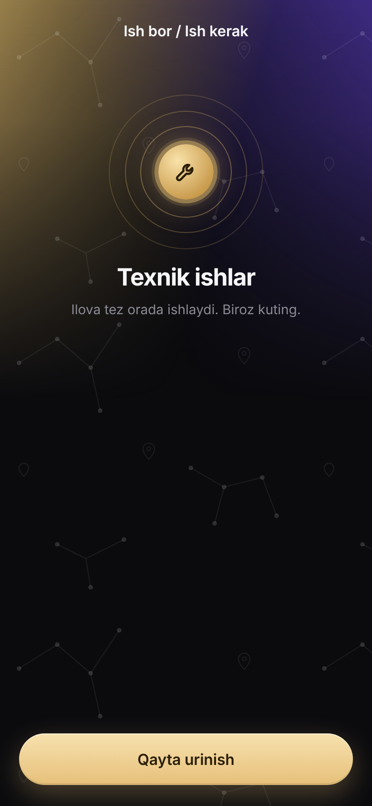

Nazoratda “Texnik ishlar rejimi” yoqilsa hamma (Jasurdan boshqa) ilovani ochganda shu oynani ko‘radi: kalit belgisi, “Texnik ishlar”, “Ilova tez orada ishlaydi. Biroz kuting.”, oltin “Qayta urinish” (qayta tekshiradi). “Yangi e’lonlarni to‘xtatish” yoqilsa — “E’lonni joylash” bosilganda Telegram ogohlantirishi: “Hozir yangi e’lon qabul qilinmayapti. Birozdan keyin urinib ko‘ring.”

### 3.31 Bot xabarlari — `31-bot-xabarlari`

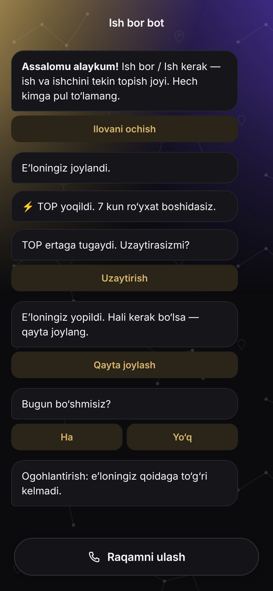

Botning hamma xabarlari 9-bo‘limda. Rasmda ularning ko‘rinishi: oddiy Telegram xabari va ostida tugma(lar).

## 4. Umumiy qoidalar

### 4.1 O‘tishlar

| Qayerdan | Nima bosiladi | Qayerga |
| --- | --- | --- |
| Istalgan asosiy oyna | Pastki menyu: Bosh sahifa / E’lonlar / Profil | Shu oyna |
| Istalgan asosiy oyna | “+” | 3.5 yoki 3.6 (oxirgi tanlangani) |
| 3.1 | “Ish bor” kartasi, “Barchasi” | 3.2 “Ish bor” |
| 3.1 | “Ish kerak” kartasi | 3.2 “Ish kerak” |
| 3.1, 3.2 | Qidiruv | 3.2, qidiruv faol |
| 3.1, 3.2 | Hudud tugmasi / chipi | 3.11 |
| 3.2 | “Ish turi”, “Erkak / Ayol” chiplari | 3.27, 3.28 |
| 3.1, 3.2 | “Ish bor” kartasi | 3.3 (o‘ziniki bo‘lsa 3.12; yopilgan bo‘lsa 3.20) |
| 3.2 | “Ish kerak” kartasi | 3.4 (o‘ziniki bo‘lsa 3.13) |
| 3.2 bo‘sh | “+ E’lon joylash” | 3.5 / 3.6 |
| 3.3, 3.4 | “Shikoyat qilish” | 3.10 → 3.26 |
| 3.5 | “Manzil” / “Qachon” / “Kunlik”, “Soatlik” | 3.11 / 3.16 / 3.17 |
| 3.6 | “Hudud” / “Kunlik haq” / “Qo‘shimcha” | 3.11 / 3.17 / 3.18 |
| 3.5, 3.6 | “E’lonni joylash” | 3.7 (bloklangan bo‘lsa 3.29) |
| 3.7 | “Bosh sahifaga” | 3.1 |
| 3.8 | E’lon kartasi | 3.12 / 3.13 |
| 3.8, 3.12, 3.13 | “TOP qilish” | 3.9 (yoqiq bo‘lsa 3.23) |
| 3.9, 3.23 | Oltin tugma | 3.14 |
| 3.14 | “To‘lash” | to‘lov ilovasi + 3.21 → 3.15 yoki 3.22 |
| 3.15 | “Mening e’lonlarim” | 3.8 |
| 3.8 | Mavzu / Yordam / Nazorat bo‘limi | 3.24 / 3.25 / Nazorat A |
| Bot xabaridagi tugma | “Ilovani ochish”, “Uzaytirish”, “Qayta joylash” | Ilova, mos oynada (`p` parametri, 9.2) |

Telegram’ning “Orqaga” tugmasi ilova ichidagi orqaga tugmasi bilan bir xil ishlaydi. Asosiy oynalarda (3.1, 3.2 menyudan ochilgan, 3.8) u yashirin. Pastdan chiqadigan oyna ochiq bo‘lsa avval o‘sha yopiladi. Yarim to‘ldirilgan forma yopilayotganda so‘ralmaydi (ma’lumot saqlanib qoladi).

### 4.2 E’lon nomi

Formada sarlavha maydoni yo‘q, nom o‘zi yasaladi:
- “Ish bor”: “<Ish turi>, <kishi> ta ishchi” — masalan “Yuk tashish, 2 ta ishchi”. Kishi 1 bo‘lsa “Yuk tashish, 1 ta ishchi”.
- “Ish kerak”: Telegram ismi va familiyaning birinchi harfi — “Aziza K.”; familiya yo‘q bo‘lsa faqat ism.
- Kirill yozuvida nom ham kirillda ko‘rsatiladi (ish turi nomlari lug‘atdan, ism o‘giruvchi orqali).

### 4.3 TOP

- Narxi 5 000 so‘m, muddati 7 kun (ikkalasi Nazoratda o‘zgaradi). Bitta vazifa: ro‘yxat boshida turish.
- TOP faqat filtrga mos kelganda boshida chiqadi. Hudud, masofa, ish turi, jinsi yoki qidiruv so‘ziga mos kelmasa — umuman ko‘rinmaydi.
- TOP ko‘k “⚡ TOP” belgisi va oltin chegara bilan ajraladi.
- TOP oynasiga faqat “TOP qilish” orqali kiriladi. Hech qayerda reklama, qalqib chiquvchi taklif yo‘q.
- E’lon joylash doim bepul va cheksiz.
- Bir necha TOP bo‘lsa, ular orasida TOP yoqilgan vaqti yangisi tepada.
- Uzaytirilsa, tugash sanasiga 7 kun qo‘shiladi.
- “Odam topdim” bosilsa TOP to‘xtaydi; e’lon “Qayta joylash” qilinsa qolgan TOP kunlari davom etadi (to‘xtagan vaqt qo‘shib beriladi). Pul qaytarilmaydi (faqat Nazoratdan qo‘lda).

### 4.4 Hudud va masofa

- Har kim tumanni qo‘lda yoki lokatsiya bilan tanlaydi va masofani belgilaydi: 1–5, 5–10, 10–20, 20–35 km, “35 km dan uzoq”.
- Masofa to‘g‘ri chiziq bo‘yicha (haversine) hisoblanadi: qidirayotgan odamning nuqtasi (lokatsiya yoki tuman markazi) va e’lon nuqtasi orasida.
- Filtr: masofa tanlangan oraliqning **yuqori chegarasidan** oshmagan e’lonlar chiqadi (5–10 km → 10 km gacha). “35 km dan uzoq” — masofa cheklanmaydi.
- Ishchi uchun masofa “shu masofada ishlayman”; ish beruvchi uchun “ishchilar shu masofagacha”. Qidiruvda: “Ish bor” ro‘yxatida e’lon faqat qidiruvchining masofasi bo‘yicha filtrlanadi; ish beruvchi belgilagan masofa ham qo‘shimcha shart — qidiruvchi undan uzoqda bo‘lsa e’lon unga chiqmaydi. “Ish kerak” ro‘yxatida xuddi shunday ishchining masofasi ham hisobga olinadi.
- Kartadagi masofa: 1 km dan kam — “800 m”, ko‘p bo‘lsa — “1,2 km” (vergul bilan).
- Hudud tanlanmagan odamga hamma e’lonlar ko‘rinadi, masofa yozilmaydi.

### 4.5 Holatlar

- Bo‘sh holat: sonlar 0, ro‘yxat o‘rnida bo‘sh karta va keyingi qadam. Soxta ism, narx yoki e’lon yo‘q.
- Faol emas tugma: majburiy maydonlar to‘lmaguncha oltin tugma 45% xira, soyasiz, bosilmaydi. Bosilsa yengil tebranish (`notificationOccurred('warning')`) va birinchi to‘ldirilmagan joy 2 marta oltin chegara bilan miltillaydi.
- Tanlangan: doim ko‘k. Yoqilgan / ijobiy: doim yalpiz.
- Yuklanmoqda: skelet kartalar; tugmada aylanuvchi belgi.
- Xato (server javob bermadi): Telegram ogohlantirishi `showAlert('Xatolik. Qaytadan urinib ko‘ring.')`, kiritilgan ma’lumot yo‘qolmaydi.

### 4.6 Yozuv va matn

- Ikki yozuv: lotin va kirill. Profildagi “Yozuv” butun ilovani, bot xabarlarini ham almashtiradi. “TOP” va to‘lov ilovalari nomlari (Payme, Click, Uzum Bank, Paynet, Multicard) ikkala yozuvda lotincha qoladi. Plitkadagi harflar (P, C, U, M) ham lotin. “Yozuv” segmentidagi “Lotin | Кирилл” ikkala yozuvda ham shunday turadi.
- Hamma ilova matnlari lotincha lug‘atda; kirillchasi `cyr.js` qoidasi bilan bir marta yasaladi va lug‘atga yoziladi (dastur ishlayotganda emas). Qo‘lda tekshirilgan istisnolar lug‘atda.
- Odam yozgan matn (izoh, qo‘shimcha) qanday yozilgan bo‘lsa shunday ko‘rsatiladi.
- Matnlar juda qisqa va oddiy. Har oynada bitta asosiy amal.
- Ikki ma’noli so‘z ishlatilmaydi (“asbob” emas — “ish qurollari”).
- Eslatmalar: “Hech kimga pul to‘lamang”, “Oldindan pul bermang”, “Ilova pul olmaydi”.
- Asosiy aloqa — qo‘ng‘iroq, ikkinchisi — Telegram.
- Sana va vaqt Toshkent vaqtida (UTC+5). Sana “12-noyabr”, oylar: yanvar, fevral, mart, aprel, may, iyun, iyul, avgust, sentabr, oktabr, noyabr, dekabr. “Bugun”, “Ertaga”, “Indinga”. Kartadagi o‘tgan vaqt: “hozir”, “5 daq”, “2 soat”, “kecha”, “3 kun”.
- Pul: “250 000 so‘m”, bo‘sh joy bilan, tiyin ko‘rsatilmaydi.

### 4.7 Kirish va ro‘yxatdan o‘tish

- Alohida ro‘yxatdan o‘tish yo‘q. Ilova ochilganda Telegram bergan `initData` serverda tekshiriladi va odam Telegram ID si bo‘yicha taniladi. Ism, username, rasm, til Telegramdan olinadi.
- Telefon raqami faqat kerak bo‘lganda so‘raladi (“Raqamim ko‘rinsin” yoqilganda yoki botdagi “📱 Raqamni ulash” tugmasi). Raqam faqat Telegram orqali tasdiqlangan holda qabul qilinadi (9.2).

## 5. E’lonning hayoti, “Odam topdim”, “Band”, shikoyat

### 5.1 E’lon holatlari

| Holat | Kim ko‘radi | Qachon |
| --- | --- | --- |
| `tekshirilmoqda` | Faqat egasi (“Tekshirilmoqda”) va Nazorat | Izohda shubhali so‘z bor yoki e’lon avtomatik yashirildi |
| `faol` | Hamma | Joylangach (yoki Nazorat tasdiqlagach) |
| `yopilgan` | Faqat egasi (“Yopilgan”) | “Odam topdim”, “Qachon” o‘tdi, 30 kunlik so‘rovga javob yo‘q |
| `rad_etilgan` | Egasi (“Rad etildi”) | Nazorat rad etdi; egasiga bot sababini yozadi |
| `yashirin` | Faqat egasi | Nazorat 1/3/5 kunga yashirdi; muddat tugasa o‘zi `faol` |
| `o‘chirilgan` | Hech kim | Egasi bloklandi |

### 5.2 Raqam va aloqa
- “Raqamim ko‘rinsin” yoqiq — e’londa “Qo‘ng‘iroq qilish” bor. O‘chiq — faqat “Telegramda yozish”.
- Username’i yo‘q odamda raqam doim ko‘rinadi (aks holda unga bog‘lanib bo‘lmaydi).
- Ro‘yxatda raqam ko‘rinmaydi; faqat tafsilotda, tugma ichida (raqam matni chiqmaydi, tugma bosilganda teriladi). Bu raqamlarni yig‘ib olishni qiyinlashtiradi; server bitta odamga soatiga 60 tadan ko‘p raqam bermaydi.
- Qo‘ng‘iroq va Telegram tugmasi bosilishlari sanaladi (TOP statistikasi uchun).

### 5.3 “Odam topdim”
- Faqat “Ish bor” egasi ko‘radi: Profil kartasida “TOP qilish · Odam topdim” va 3.12 da oltin “✓ Odam topdim”.
- Bosilganda tasdiq so‘ralmaydi: e’lon darhol `yopilgan`, qidiruvdan, “Yaqin atrofda”dan, filtrlardan olinadi. Profilda “Yopilgan” + “Qayta joylash”. Xato bosilsa “Qayta joylash” bir bosishda qaytaradi.
- Ochiq turgan tafsilotdagilar uchun keyingi yangilanishda 3.20 ko‘rinadi.
- TOP bo‘lsa to‘xtaydi (4.3).
- “Qachon” kuni o‘tgach, o‘sha kunning ertasi 00:00 da (Toshkent) e’lon o‘zi yopiladi va bot yozadi: “E’loningiz yopildi. Hali kerak bo‘lsa — qayta joylang.” [Qayta joylash].

### 5.4 “Band”
- Almashtirgichni faqat “Ish kerak” egasi ko‘radi (3.13 va profildagi “Band”). Belgini hamma ko‘radi (ro‘yxat kartasi, 3.4).
- Band ishchi qidiruvdan olinmaydi va pastga tushmaydi. “Faqat bo‘shlar” filtri yo‘q. TOPga ta’siri yo‘q.
- Ishchi belgilagan bo‘sh kunlaridan biri kelganda, agar u band bo‘lsa, ertalab 08:00 da bot so‘raydi: “Bugun bo‘shmisiz?” [Ha] [Yo‘q]. “Ha” — “Band” o‘chadi. “Yo‘q” yoki javobsiz — o‘zgarmaydi. Bir kunda bir martadan ko‘p so‘ralmaydi.

### 5.5 Shikoyat va avtomatik himoya
- Shikoyat Nazorat → Navbat ga tushadi. Bitta e’longa 3 ta turli odam shikoyat qilsa (yoki 2 ta “Ish uchun pul so‘rashdi”), e’lon avtomatik `tekshirilmoqda` bo‘ladi va Navbatda qizil “Jiddiy” turadi. Avtomatik amal jurnalga yoziladi va Nazoratda bekor qilinishi mumkin.
- Shubhali so‘zlar (8.3) izohda yoki qo‘shimchada bo‘lsa, e’lon `tekshirilmoqda` bo‘lib Navbatga tushadi. Egasi 3.7 ni odatdagidek ko‘radi, profilda “Tekshirilmoqda”. Tasdiqlangach `faol` va bot: “E’loningiz joylandi.”
- Matnda telefon raqami yoki 16 xonali karta raqamiga o‘xshash son bo‘lsa ham shunday.
- Ovozli izohlar avtomatik tekshirilmaydi; ularda shikoyat bo‘lsa Navbatda tinglanadi.

## 6. Nazorat bo‘limi (faqat Jasur)

Ilovani boshqarish uchun yopiq bo‘lim. Dizayni ilova bilan bir xil. Ikki mavzu va ikki yozuv ilova sozlamasiga ergashadi. Rasmlar bo‘sh holatda (hali hech kim yo‘q); ichki oynalarda `‹ism›`, `‹son›` kabi burchakli qavsdagi yozuvlar — o‘sha joyga bazadan nima tushishini ko‘rsatadi.

### 6.1 Ikki qavat himoya
1. **Raqam.** “Nazorat bo‘limi” qatori faqat tasdiqlangan telefon raqami `ADMIN_PHONE` (+998 99 320 02 53) ga teng odamga ko‘rinadi, Profilning eng pastida. Buni server tekshiradi: boshqa odamga bu qator va Nazorat ma’lumotlari umuman yuborilmaydi. Raqam faqat Telegram orqali tasdiqlangan bo‘lishi shart (9.2); qo‘lda yozilgan raqam hisobga olinmaydi.
2. **Kod.** Shu raqamdan kirilgan bo‘lsa ham, 12 belgili kodni bilmagan odam kira olmaydi.
- Har bir Nazorat so‘rovida server ikkalasini qayta tekshiradi (faqat tugmani yashirish yetmaydi).
- Kod serverda faqat argon2id xesh ko‘rinishida saqlanadi. Ochiq kod dastur kodida, bazada, jurnalda, bu hujjatda yo‘q. Boshlang‘ich kod server sozlamasidagi `ADMIN_INITIAL_CODE` dan birinchi ishga tushishda xeshlanib bazaga yoziladi; shundan keyin bu qiymat ishlatilmaydi (o‘chirib qo‘yish mumkin). Kodni Jasur o‘zi `.env` ga yozadi.
- 5 marta xato → 15 daqiqa qulf va botdan Jasurga xabar: “Nazoratga 5 marta xato kod kiritildi. 15 daqiqa qulflandi.” Qulf paytida kod tekshirilmaydi ham.
- Kirgach sessiya 10 daqiqa harakatsizlikdan keyin tugaydi (chipdagi vaqt). Har amal vaqtni 10:00 ga qaytaradi. Ilova yopilsa sessiya ham tugaydi.
- Har kirish (muvaffaqiyatli va xato) jurnalga: vaqt, qurilma (Telegram platformasi), natija.

### 6.2 A. Kirish

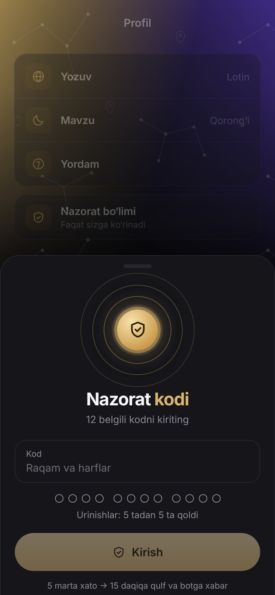

- Profil xira, pastdan oyna: halqali oltin qalqon, “Nazorat kodi”, “12 belgili kodni kiriting”.
- “Kod” maydoni, taklif “Raqam va harflar”; telefon klaviaturasi ochiladi (harf va raqam, katta-kichik harf farqlanadi), yozilgani nuqta bo‘lib yashirinadi.
- 12 ta nuqta (4+4+4): har kiritilgan belgi bilan bittasi oltin to‘ladi.
- “Urinishlar: 5 tadan 5 ta qoldi” (har xatoda kamayadi; xatoda maydon qizil chiziq va qisqa tebranish).
- Oltin “Kirish” — 12 belgi bo‘lmaguncha xira. To‘g‘ri bo‘lsa → B.
- Pastda: “5 marta xato → 15 daqiqa qulf va botga xabar”. Qulf paytida tugma o‘rnida “Qulflangan · 14:32” teskari sanaydi.

### 6.3 B. Bugun

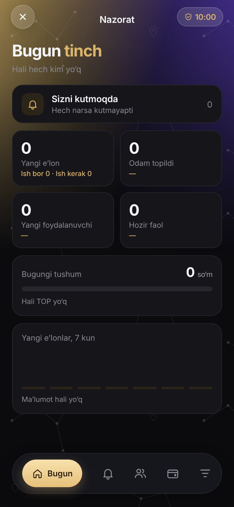

- Tepada “✕” (chiqish), o‘ngda vaqt chipi.
- “Bugun tinch” (Navbatda narsa bo‘lsa “Bugun <n> ta muammo”), ostida qisqa holat (“Hali hech kim yo‘q” yoki bugungi sana).
- “Sizni kutmoqda” qatori: son va izoh (“3 shikoyat · 2 to‘lov · 1 savol”; bo‘sh — “Hech narsa kutmayapti”). Bosilsa C.
- 2×2 kartalar: Yangi e’lon (Ish bor / Ish kerak bo‘yicha), Odam topildi (bugun “Odam topdim” bosilganlar), Yangi foydalanuvchi (kechagiga nisbatan “+3”), Hozir faol (oxirgi 15 daqiqada ilovani ochganlar; ostida eng faol tuman).
- Bugungi tushum: summa, oltin chiziq (TOP to‘lovlari), “<n> ta TOP · 5 000 so‘mdan” (bo‘sh — “Hali TOP yo‘q”).
- “Yangi e’lonlar, 7 kun” — 7 ustun, bugungisi oltin (bo‘sh — tekis, “Ma’lumot hali yo‘q”).
- Pastki menyu: Bugun (faol) · Navbat · Odamlar · Pul · Yana.

### 6.4 C. Navbat va H. Navbat elementi

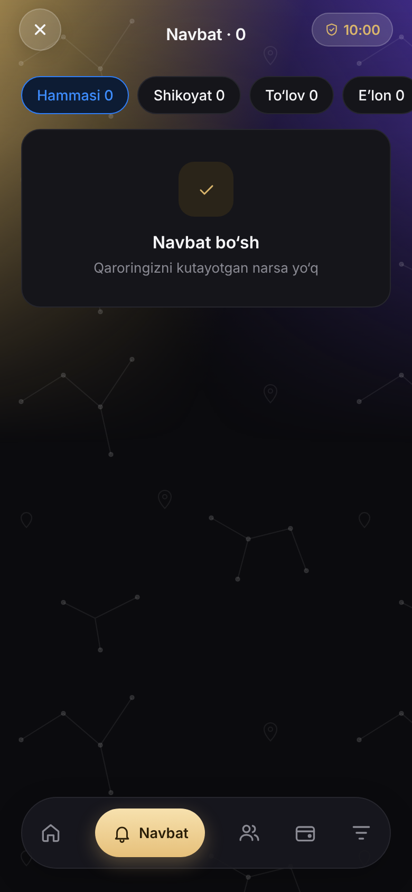 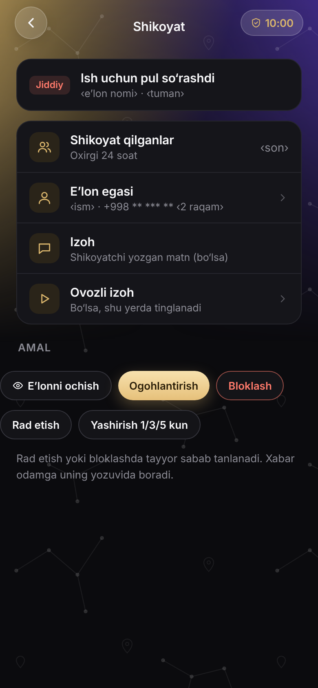

- “Navbat · <son>”, chiplar: Hammasi, Shikoyat, To‘lov, E’lon, Savol (har birida son).
- Bo‘sh: “Navbat bo‘sh”, “Qaroringizni kutayotgan narsa yo‘q”.
- Element turlari:

| Yorliq | Nima | Tugmalar |
| --- | --- | --- |
| Jiddiy (qizil) | 2+ “pul so‘rashdi” yoki 3+ turli shikoyat | E’lonni ochish · Ogohlantirish · Bloklash · Rad etish · Yashirish 1/3/5 kun |
| Shikoyat (oltin) | Oddiy shikoyat | xuddi shu |
| To‘lov · 60 s o‘tdi | Multicard tasdig‘i 60 soniyada kelmagan to‘lov | Holatni tekshirish · Multicard kabineti |
| Shubhali e’lon | Shubhali so‘z, telefon yoki karta raqami bor | Tasdiqlash · Rad etish |
| Savol (ko‘k) | Botga yozilgan xabar | Javob yozish |

- H oynasi (element bosilganda): sabab, e’lon nomi va tumani, “Shikoyat qilganlar” soni, “E’lon egasi” (bosilsa I), izoh va ovozli izoh (▶).
- “Ogohlantirish” — tayyor matn tanlanadi va bot orqali egasiga boradi. “Rad etish” — sabab tanlanadi: “Ish uchun pul so‘ralgan”, “Yolg‘on ma’lumot”, “Haqoratli so‘z”, “Takroriy e’lon”, “Boshqa”; e’lon `rad_etilgan`, egasiga bot sababini uning yozuvida yozadi. “Bloklash” — sabab majburiy, “Ishonchingiz komilmi?” so‘raladi. “Yashirish” — 1, 3 yoki 5 kunga qidiruvdan olinadi (ban emas).
- “Javob yozish” — matn maydoni; yuborilsa bot o‘sha odamga yozadi.
- Hal qilingan element Navbatdan chiqadi, jurnalda qoladi.

### 6.5 D. Odamlar va I. Odam kartasi

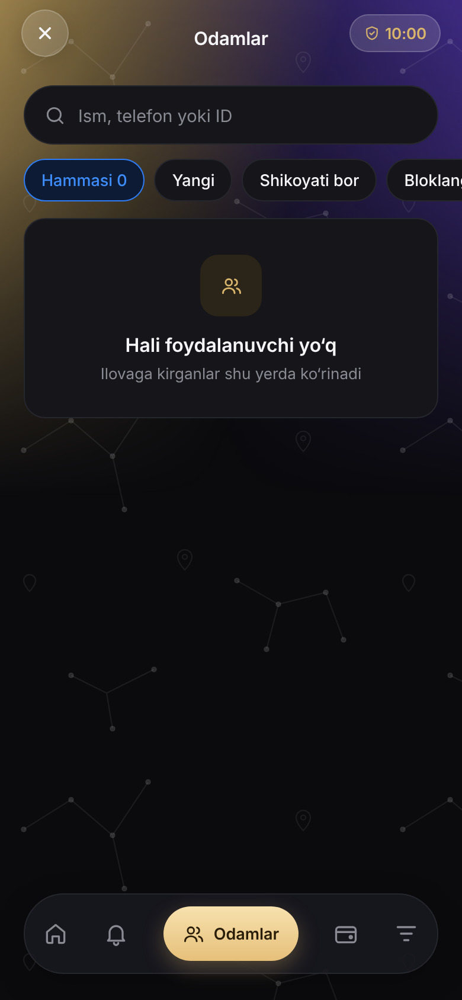 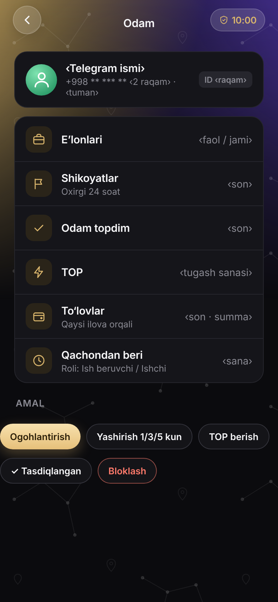

- Qidiruv “Ism, telefon yoki ID”; chiplar: Hammasi, Yangi (7 kun), Shikoyati bor, Bloklangan, TOP. Bo‘sh — “Hali foydalanuvchi yo‘q”.
- Ro‘yxat qatori: avatar, ism, TOP belgisi, telefon yarim yopiq (“+998 90 *** ** 45”), tuman, roli.
- I oynasi: avatar, ism, yarim yopiq telefon, tuman, ID; qatorlar — E’lonlari (faol/jami, bosilsa ro‘yxat), Shikoyatlar (24 soatda), Odam topdim soni, TOP (tugash sanasi), To‘lovlar (soni, summa, ilovasi), Qachondan beri va roli.
- Amallar: Ogohlantirish · Yashirish 1/3/5 kun · TOP berish (to‘lovsiz, kun soni tanlanadi, jurnalga “qo‘lda” deb yoziladi) · “✓ Tasdiqlangan” belgisi (ism yonida chiqadi) · Bloklash (sabab, qayta tasdiq; e’lonlari o‘chadi, 3.29 ko‘radi; “Blokdan chiqarish” bilan qaytadi).
- To‘liq telefon raqami faqat “Ko‘rsatish” bosilganda chiqadi va bu ham jurnalga yoziladi.

### 6.6 E. Pul va J. To‘lov tafsiloti

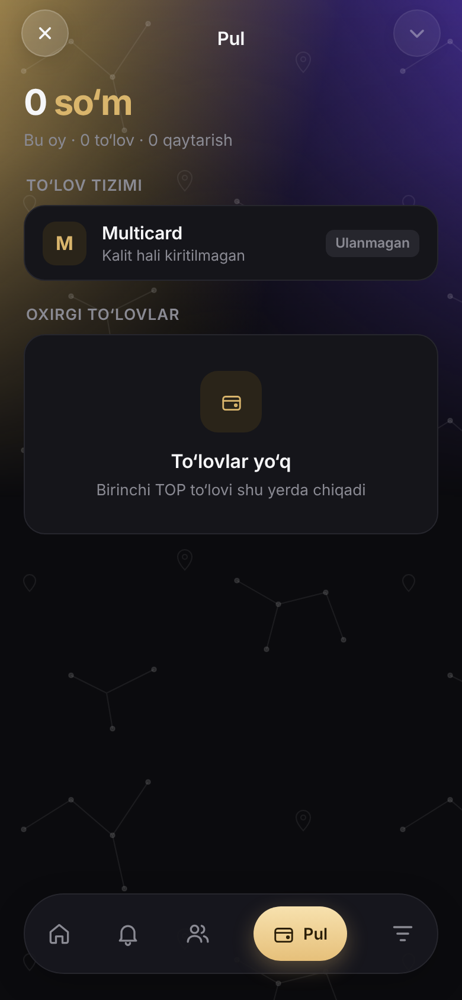 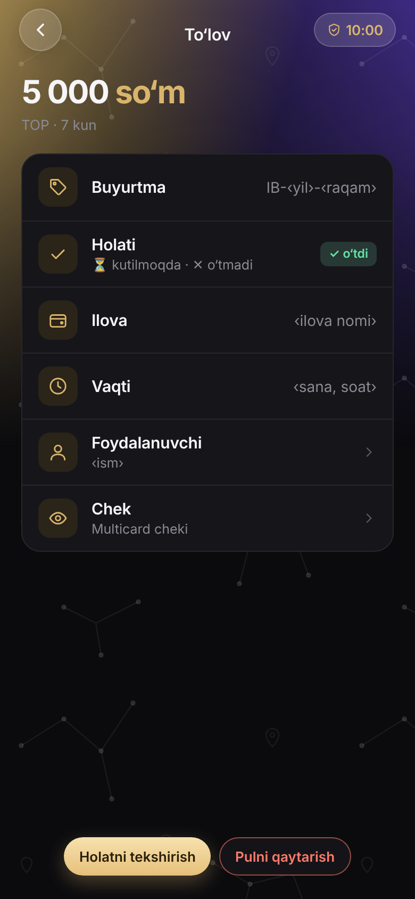

- Oy tushumi katta raqamda, ostida “<oy> · <n> to‘lov · <n> qaytarish”. O‘ng tepada “⤓” — Excel (.xlsx) yuklab olish: sana, buyurtma, odam ID, e’lon, ilova, summa, holat. Fayl bot orqali Jasurga yuboriladi.
- “To‘lov tizimi”: Multicard qatori — “Ulanmagan · Kalit hali kiritilmagan” (kulrang), “● Ishlayapti” (yalpiz) yoki “Xato” (qizil, oxirgi xato matni bilan). Ostida qaysi ilova orqali to‘langani chizig‘i.
- “Oxirgi to‘lovlar”: tarif, buyurtma raqami, ilova, vaqt, summa, holat — ✓ o‘tdi (yalpiz), ⏳ kutilmoqda, ✕ o‘tmadi (qizil). Bo‘sh — “To‘lovlar yo‘q”.
- J: summa, “TOP · 7 kun”, Buyurtma `IB-<yil>-<raqam>`, Holati, Ilova, Vaqti, Foydalanuvchi (→ I), Chek (Multicard `receipt_url`). “Holatni tekshirish” — Multicard’dan so‘raydi. “Pulni qaytarish” — tasdiq so‘raladi, Multicard orqali qaytaradi, TOP o‘chadi.
- Multicard ishlamasa yoki 3 to‘lov ketma-ket o‘tmasa — botdan darhol xabar.

### 6.7 F. Yana va ichki oynalar

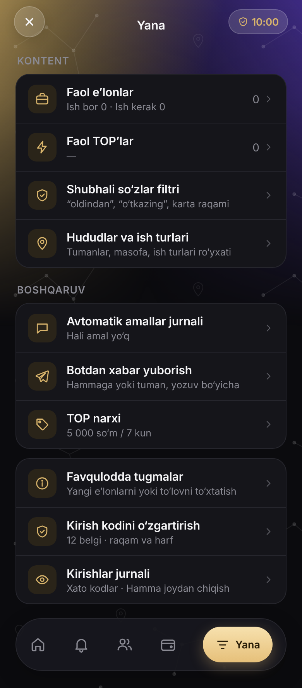

- **Kontent:** Faol e’lonlar → R; Faol TOP’lar (ro‘yxat: e’lon, tugash sanasi, ko‘rishlar, qo‘ng‘iroqlar); Shubhali so‘zlar filtri → K; Hududlar va ish turlari → Q.
- **Boshqaruv:** Avtomatik amallar jurnali → P; Botdan xabar yuborish → L; TOP narxi → M; Kirish kodini o‘zgartirish → G.
- **Favqulodda tugmalar** → N. **Kirishlar jurnali** → O.

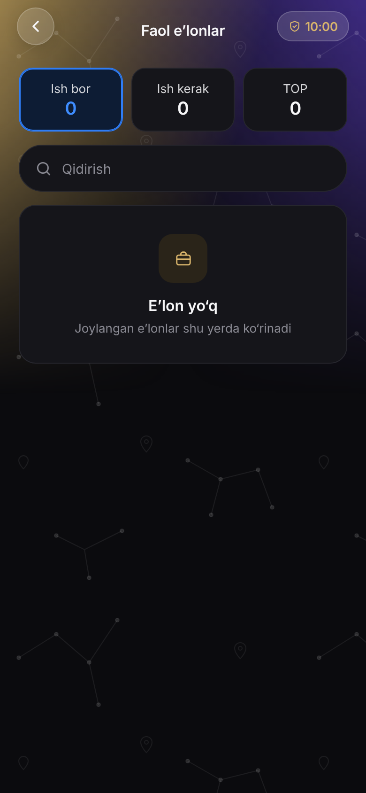 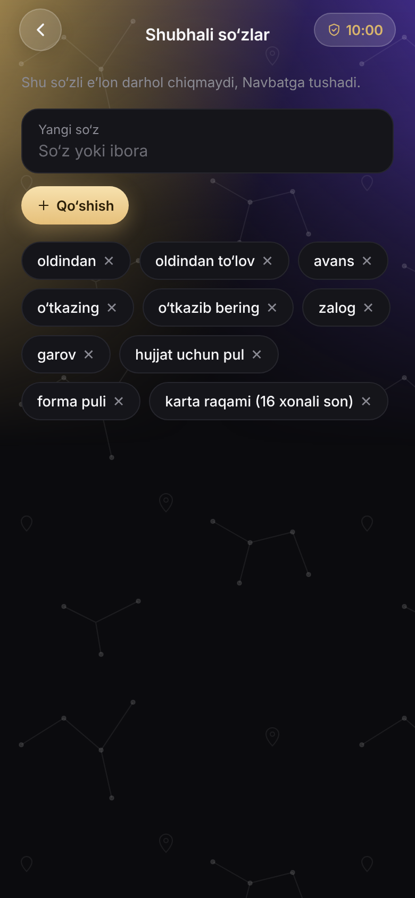 

- R. Faol e’lonlar: uchta tanlov (Ish bor, Ish kerak, TOP) sonlari bilan, qidiruv, e’lon kartalari; karta bosilsa e’lon va egasiga amallar (Yashirish, Rad etish, Egasini ochish).
- K. Shubhali so‘zlar: “Yangi so‘z” maydoni, “+ Qo‘shish”, so‘zlar chiplari “✕” bilan o‘chiriladi. Boshlang‘ich ro‘yxat 8.3 da.
- Q. Hududlar va ish turlari: tumanlar almashtirgich bilan (o‘chirilgani ilovada ko‘rinmaydi), “+ Hudud qo‘shish” (nom lotin va kirill, markaz nuqtasi xaritadan yoki koordinata). Ish turlari chiplari, “+ Qo‘shish” (nom ikkala yozuvda va belgi ro‘yxatdan tanlanadi). Ishlatilgan turni o‘chirib bo‘lmaydi, faqat yashirish mumkin.

  

- L. Botdan xabar: “Kimga” — Hammaga | Tuman | Ish beruvchi | Ishchi (Tuman tanlansa tumanlar ro‘yxati); “Yozuv” — Ikkalasi | Lotin | Кирилл (lotinchada yozilgani kirillga o‘zi o‘giriladi); “Matn”; “<n> kishiga boradi”. “Yuborish” — tasdiq so‘raladi, sekundiga 25 tadan yuboriladi, botni bloklaganlar o‘tkazib yuboriladi, oxirida natija: “<n> ta yetdi, <n> ta yetmadi”.
- M. TOP narxi: Narx (so‘m) va Muddat (kun). “Saqlash” — o‘zgarish bo‘lmaguncha xira; yangi narx keyingi to‘lovlardan amal qiladi, ilovani yangilash shart emas.
- N. Favqulodda: “Yangi e’lonlarni to‘xtatish”, “To‘lovlarni o‘chirish”, “Texnik ishlar rejimi” — almashtirgichlar; yoqish va o‘chirishda tasdiq; jurnalga yoziladi. Texnik rejimda Jasur ilovani odatdagidek ko‘radi.

 

- O. Kirishlar: chiplar Hammasi | Xato kodlar; har yozuv — vaqt, qurilma, natija. Qizil “Hamma joydan chiqish” — boshqa barcha Nazorat sessiyalarini yopadi.
- P. Avtomatik amallar: qoidalar ro‘yxati (3 shikoyat → yashirish; shubhali so‘z → Navbat; “Qachon” o‘tdi → yopish; TOP tugadi → o‘chirish va xabar) va jurnal; har yozuvda “↩ Bekor qilish”.

### 6.8 G. Kirish kodini o‘zgartirish

- “Kirish kodi”, halqali qalqon, “Kodni o‘zgartirish”, “Yangi kod 12 belgi: raqam va harf”.
- Maydonlar: “Hozirgi kod” (yashirin), “Yangi kod”, “Yangi kodni qaytaring”.
- Shartlar (bajarilsa belgi yonadi): 12 ta belgi; kamida 1 harf va 1 raqam; ikkalasi bir xil. Faqat lotin harflari va raqamlar.
- Oltin “Saqlash” — shartlar bajarilmaguncha xira. Hozirgi kod xato bo‘lsa — qizil “Hozirgi kod noto‘g‘ri” va 5 urinish hisobiga kiradi.
- Saqlanganda: yangi xesh yoziladi, boshqa Nazorat sessiyalari yopiladi, jurnalga “Kod o‘zgartirildi”, botdan Jasurga xabar.
- Kod esdan chiqsa: serverda `npm run admin:reset-code` buyrug‘i yangi kod so‘raydi va xeshlab yozadi.

### 6.9 Jurnal
Nazoratdagi har amal (kim, qachon, nima, qaysi obyekt, oldingi va yangi qiymat) jurnalga yoziladi. Xavfli amallarda (Bloklash, Pulni qaytarish, Botdan xabar, Favqulodda, Hamma joydan chiqish) “Ishonchingiz komilmi?” so‘raladi. Ro‘yxatlarda telefon yarim yopiq, karta ma’lumoti umuman saqlanmaydi.

## 7. TOP to‘lovi (Multicard)

Manba: Multicard rasmiy hujjati [docs.multicard.uz](https://docs.multicard.uz/) (2026-10-28 da o‘qildi). Shartnomadan keyin Multicard bergan hujjat bilan farq bo‘lsa, Multicard hujjati to‘g‘ri hisoblanadi.

### 7.1 Kalitlar (shartnomadan keyin `.env` ga yoziladi, boshqa hech narsa o‘zgarmaydi)

| Kalit | Nima | Qayerdan |
| --- | --- | --- |
| `MULTICARD_APPLICATION_ID` | Ilova ID | Multicard beradi |
| `MULTICARD_SECRET` | Maxfiy kalit (callback imzosi ham shu bilan) | Multicard beradi |
| `MULTICARD_STORE_ID` | Do‘kon ID | Multicard beradi |
| `MULTICARD_ENV` | `prod` yoki `sandbox` | Siz tanlaysiz |
| `MULTICARD_APPS` | Ro‘yxatda ko‘rinadigan ilovalar, tartibi bilan. Boshida: `payme,click,uzum,multicard` | Multicard do‘koningizda yoqilganlar |
| `MULTICARD_OFD_MXIK` | Soliq (OFD) chekidagi xizmat kodi (MXIK) | Multicard yoki buxgalter beradi |
| `MULTICARD_OFD_PACKAGE_CODE` | O‘lchov birligi kodi | xuddi shu |

- Bu kalitlar bo‘lmasa, to‘lov o‘chiq: ilovada “TOP qilish” ko‘rinmaydi, Nazorat → Pul da “Ulanmagan · Kalit hali kiritilmagan”. Kalitlar yozilib server qayta ishga tushirilsa (`docker compose up -d`), hammasi o‘zi yoqiladi.
- Kalitlar faqat serverda. Mini ilovaga hech qachon yuborilmaydi.
- **Paynet:** Multicard hujjatidagi ilovalar ro‘yxatida Paynet yo‘q (Payme, Click, Uzumbank, Anorbank, Oson, Alif, Xazna, Beepul, Trastpay bor). Shuning uchun Paynet qatori faqat `MULTICARD_APPS` ga `paynet` qo‘shilsa chiqadi. Rasmdagi tartib va ko‘rinish saqlanadi, faqat yoqilmagan qator chiqmaydi.

### 7.2 Manzillar
- Asosiy: `https://mesh.multicard.uz/`; sinov: `https://dev-mesh.multicard.uz/`.
- Token: `POST /auth` `{application_id, secret}` → `{token, expiry}`. Token `expiry` dan 5 daqiqa oldin yangilanadi; so‘rovlarda `Authorization: Bearer <token>`.
- Ilova orqali to‘lov: `POST /payment` `{payment_system, amount, store_id, invoice_id, callback_url, ofd[]}` → `data.checkout_url` (to‘lov ilovasini ochuvchi Universal Link/App Link), `data.uuid`.
- Multicard sahifasi (karta bilan, “Multicard” qatori): `POST /payment/invoice` `{store_id, amount, invoice_id, lang, return_url, callback_url, ofd[]}` → `data.checkout_url`, `data.uuid`.
- Holatni so‘rash: invoys/to‘lov ma’lumotini olish (`GET`, hujjatdagi “Получение информации …”).
- Qaytarish: to‘lovni bekor qilish (`DELETE`, “Отмена платежа (возврат средств)”).
- Summa tiyinda: 5 000 so‘m = `500000`. Sinov rejimida bir marta 1 so‘mlik to‘lov bilan birlik tekshiriladi (Codex vazifasi, 12-bo‘lim).
- `payment_system` qiymatlari: `payme`, `click`, `uzum` (hujjatda “Uzumbank”; aniq yozilishi sinovda tekshiriladi), `paynet` (agar Multicard yoqsa).

### 7.3 Ketma-ketlik
1. 3.14 da “To‘lash” → ilova serverga `POST /api/top/checkout {listingId, app}` yuboradi.
2. Server: e’lon shu odamniki va faol ekanini, to‘lov yoqiqligini tekshiradi. Narx va kun **serverdagi sozlamadan** olinadi (ilovadan kelgan summa qabul qilinmaydi). `payments` jadvaliga `kutilmoqda` yozuvi, buyurtma raqami `IB-<yil>-<6 xonali tartib raqam>`.
3. Server Multicard’ga so‘rov yuboradi (`app=multicard` → invoys, boshqasi → `/payment`). `ofd`: `[{qty:1, price:500000, total:500000, mxik, package_code, name:"TOP · 7 kun", vat:0}]`. `callback_url` = `https://<DOMAIN>/api/pay/multicard/callback`. `return_url` = `https://t.me/<bot_username>`.
4. Ilova `checkout_url` ni `Telegram.WebApp.openLink(url)` bilan ochadi → telefonda to‘lov ilovasi summa bilan ochiladi → 3.21.
5. Multicard callback yuboradi: `{store_id, amount, invoice_id, billing_id, payment_time, phone, card_pan, ps, card_token, uuid, receipt_url, sign}`.
6. Server tekshiradi: `sign == md5(store_id + invoice_id + amount + MULTICARD_SECRET)` (bo‘sh joysiz qo‘shib), so‘rov IP manzili `195.158.26.90` (sozlamada `MULTICARD_CALLBACK_IPS`), `invoice_id` bazada bor, summa mos. Mos bo‘lmasa `{"success":false,"message":"..."}`.
7. Mos bo‘lsa (bir tranzaksiyada): to‘lov `o‘tdi`, TOP yoqiladi yoki uzaytiriladi (`top_until = max(hozir, top_until) + 7 kun`), `receipt_url` saqlanadi. Javob HTTP 200 `{"success":true,"message":"ok"}`. Shu `uuid` bilan takror callback kelsa — o‘zgarishsiz yana `success:true` (ikki marta hisoblanmaydi).
8. Bot: “⚡ TOP yoqildi. 7 kun ro‘yxat boshidasiz.” [Ilovani ochish].
9. Ilova 3 soniyada bir `GET /api/top/checkout/<id>` so‘raydi → `o‘tdi` bo‘lsa 3.15.
10. 15 daqiqada callback kelmasa: server Multicard’dan holatni so‘raydi; to‘lanmagan bo‘lsa `o‘tmadi` → 3.22. Navbatga “To‘lov · 60 s o‘tdi” elementi 60 soniyadan keyin tushadi.

### 7.4 Xavfsizlik
- TOP faqat imzosi to‘g‘ri callback yoki Multicard’dan so‘ralgan holat bilan yoqiladi. Ilovadagi “muvaffaqiyat” sahifasiga ishonilmaydi.
- Bir buyurtma raqami bir marta. Summa serverda.
- Karta raqami (`card_pan`) saqlanmaydi, faqat oxirgi 4 raqami.
- Callback 5 soniyada javob beradi (aks holda Multicard to‘lovni muzlatadi).

## 8. Boshlang‘ich ma’lumotlar (birinchi ishga tushishda bazaga yoziladi)

### 8.1 Tumanlar (Toshkent shahri) va markaz nuqtalari

| Lotin | Kirill | Kenglik | Uzunlik |
| --- | --- | --- | --- |
| Bektemir | Бектемир | 41.2090 | 69.3340 |
| Chilonzor | Чилонзор | 41.2750 | 69.2040 |
| Mirobod | Миробод | 41.2870 | 69.2840 |
| Mirzo Ulug‘bek | Мирзо Улуғбек | 41.3380 | 69.3350 |
| Olmazor | Олмазор | 41.3520 | 69.2120 |
| Sergeli | Сергели | 41.2270 | 69.2190 |
| Shayxontohur | Шайхонтоҳур | 41.3260 | 69.2280 |
| Uchtepa | Учтепа | 41.2920 | 69.1690 |
| Yakkasaroy | Яккасарой | 41.2830 | 69.2560 |
| Yashnobod | Яшнобод | 41.2940 | 69.3360 |
| Yangihayot | Янгиҳаёт | 41.2050 | 69.1830 |
| Yunusobod | Юнусобод | 41.3640 | 69.2870 |

Nuqtalar taxminiy (tuman o‘rtasi). Ro‘yxat alifbo tartibida ko‘rsatiladi. Yangi hudud va viloyatlar Nazorat → Q orqali qo‘shiladi.

### 8.2 Ish turlari
Yuk tashish (truck), Qurilish (build), Tozalash (spark), Oshxona (chef), Bog‘ (leaf), Ta’mirlash (wrench), Boshqa (dots) — shu tartibda. “Istalgan ish” (check) faqat “Ish kerak” formasida, birinchi.

### 8.3 Shubhali so‘zlar
oldindan, oldindan to‘lov, avans, o‘tkazing, o‘tkazib bering, zalog, garov, hujjat uchun pul, forma puli; va avtomatik: 16 xonali son (karta raqami), matn ichidagi telefon raqami. Tekshiruv katta-kichik harf va lotin/kirill farqsiz.

### 8.4 Sozlamalar
TOP narxi 5 000 so‘m, TOP muddati 7 kun, avtomatik yashirish chegarasi 3 shikoyat (yoki 2 “pul so‘rashdi”), Nazorat sessiyasi 10 daqiqa, xato kod chegarasi 5, qulf 15 daqiqa, “Ish kerak” so‘rovi 30 kun. Favqulodda almashtirgichlar o‘chiq.

## 9. Telegram bot

### 9.1 Sozlash (server o‘zi qiladi)
Server ishga tushganda `BOT_TOKEN` bilan: `getMe` (bot nomini oladi), `setWebhook` (`https://<DOMAIN>/api/bot/<maxfiy yo‘l>`, `secret_token` bilan), `setChatMenuButton` (“Ilovani ochish”, web_app `https://<DOMAIN>/`), `setMyCommands` (`/start` — “Boshlash”, `/yordam` — “Yordam”) lotin va kirill (`language_code: ru` uchun kirill), `setMyDescription` va `setMyShortDescription`:
- Tavsif: “Ish bor / Ish kerak — ish va ishchini tekin topish joyi. Hech kimga pul to‘lamang.”
- Qisqa tavsif: “Ish va ishchi — tekin, vositachisiz.”

BotFather’da faqat bot ochiladi va token olinadi. Boshqa hech narsa qo‘lda sozlanmaydi.

### 9.2 Xabarlar va tugmalar

| Qachon | Matn | Tugmalar |
| --- | --- | --- |
| `/start` | “Assalomu alaykum! Ish bor / Ish kerak — ish va ishchini tekin topish joyi. Hech kimga pul to‘lamang.” | [Ilovani ochish] (web_app); pastki klaviaturada [📱 Raqamni ulash] (`request_contact`) |
| Kontakt keldi | “Raqamingiz ulandi.” (klaviatura yopiladi) | — |
| E’lon tasdiqlandi (navbatdan) | “E’loningiz joylandi.” | [Ilovani ochish] |
| E’lon rad etildi | “E’loningiz chiqmadi. Sabab: <sabab>.” | [Ilovani ochish] |
| TOP yoqildi | “⚡ TOP yoqildi. 7 kun ro‘yxat boshidasiz.” | [Ilovani ochish] |
| TOP ertaga tugaydi (24 soat oldin) | “TOP ertaga tugaydi. Uzaytirasizmi?” | [Uzaytirish] → ilova, 3.23 |
| TOP tugadi | “TOP muddati tugadi. E’loningiz oddiy tartibda turibdi.” | — |
| “Qachon” o‘tdi | “E’loningiz yopildi. Hali kerak bo‘lsa — qayta joylang.” | [Qayta joylash] → ilova, 3.8 |
| Band ishchi, bo‘sh kun | “Bugun bo‘shmisiz?” | [Ha] [Yo‘q] (inline, ilovasiz) |
| “Ish kerak”, 30 kun | “Hali ish qidiryapsizmi?” | [Ha] [Yo‘q] |
| Ogohlantirish | “Ogohlantirish: e’loningiz qoidaga to‘g‘ri kelmadi.” + sabab | — |
| Bloklandi | “Qoidalar buzilgani uchun hisobingiz cheklandi.” | — |
| Odam botga yozdi | — (xabar Navbat → Savol ga tushadi) | — |
| Javob (Nazoratdan) | Jasur yozgan matn | — |
| Jasurga: xato kod, kod o‘zgardi, Multicard xatosi, 3 xato to‘lov, Excel | qisqa xabar / fayl | — |

- Raqam faqat shu yo‘l bilan qabul qilinadi: botga kelgan `contact` xabarida `contact.user_id == from.id`. Ilovadagi `requestContact()` ham kontaktni botga yuboradi; ilova natijani server orqali kutadi.
- Har xabar odamning tanlagan yozuvida.
- Bot xabaridagi tugmalar `web_app` turidagi inline tugmalar: `https://<DOMAIN>/?p=<parametr>`, parametrlar `top_<id>` (3.23), `my` (3.8), `listing_<id>` (3.3). Ilova ochilganda `p` ga qarab kerakli oynani ochadi. BotFather’da qo‘shimcha sozlash kerak emas.
- Odam botni bloklagan bo‘lsa xabar o‘tkazib yuboriladi, xato bo‘lmaydi.
- Bot ommaviy xabarni sekundiga 25 tadan oshirmaydi.

## 10. Texnik tuzilma (Codex uchun)

- **Frontend:** React 18 + TypeScript + Vite, `@telegram-apps/sdk` yoki `telegram-web-app.js`. CSS — `design/html/app.html` dagi `<style>` so‘zma-so‘z (bitta `tokens.css` + komponent klasslari; Tailwind yoki boshqa UI kutubxona ishlatilmaydi). Belgilar — `P` obyektidagi SVG yo‘llari. Shrift — Inter (`@fontsource/inter` 400/500/600/700).
- **Backend:** Node.js 20 + TypeScript, Fastify, Prisma, PostgreSQL 16. Bot — grammY (webhook). Rejalashtirilgan ishlar — `node-cron` (Toshkent vaqti).
- **Fayllar:** ovozli izohlar `.ogg/.webm` server diskida (`/data/voice`), 60 soniya, 1 MB gacha; faqat egasi, e’lonni ko‘rayotganlar va Nazorat ola oladi.
- **Kirish:** har so‘rovda `Authorization: tma <initData>`; server `BOT_TOKEN` bilan HMAC tekshiradi, `auth_date` 24 soatdan eski bo‘lmasin.
- **Jadvallar:** `users` (telegram_id, ism, username, rasm, til, yozuv, mavzu, telefon, telefon_tasdiqlangan, tuman, lat, lng, masofa, bloklangan, tasdiqlangan_belgi, yaratilgan), `listings` (tur, egasi, ish_turlari[], izoh, ovoz, tuman, lat, lng, masofa, qachon, kishi, kim_uchun, jinsi, haq_turi, haq, kunlar[], belgilar[], raqam_korinsin, band, holat, top_until, top_paused_left, yaratilgan, yopilgan), `complaints`, `payments`, `job_types`, `districts`, `filter_words`, `settings`, `admin_auth` (kod xeshi, xato soni, qulf vaqti), `admin_sessions`, `audit_log`, `auto_actions`, `support_messages`, `broadcasts`, `bot_jobs`.
- **API:** `/api/me`, `/api/listings` (ro‘yxat, filtrlar, sahifalash), `/api/listings/:id`, `/api/listings` POST, `/api/listings/:id/found`, `/api/listings/:id/busy`, `/api/listings/:id/repost`, `/api/listings/:id/contact` (raqamni berish, sanash), `/api/complaints`, `/api/districts`, `/api/job-types`, `/api/top/checkout`, `/api/pay/multicard/callback`, `/api/settings/public`, `/api/admin/*` (har biri admin sessiyasini tekshiradi), `/api/bot/<secret>`.
- **Qidiruv tartibi** SQL’da: filtrlar → `top_until > now()` bo‘lganlar `top_started desc` → qolganlari `created desc`.
- **Xavfsizlik:** so‘rov tezligi cheklovi (bitta odam daqiqasiga 60 so‘rov, kod tekshirish daqiqasiga 5), hamma kiritilgan matn tozalanadi (HTML yo‘q), CORS faqat o‘z domeni, sirlar faqat `.env`.
- **Jurnal va zaxira:** har kecha 03:00 da PostgreSQL zaxirasi (`/data/backup`, 14 kunlik).

## 11. Ishga tushirish (Jasur qiladigan ishlar)

1. Telegram’da @BotFather → `/newbot` → bot nomi va username → **token**.
2. Server (Ubuntu 22.04+, 1 GB RAM yetadi) va domen (masalan `ishbor.uz`); domenning A yozuvi server IP siga.
3. Serverda: Docker o‘rnatiladi, paket papkasi ko‘chiriladi, `.env.example` → `.env`, ichiga: `BOT_TOKEN`, `DOMAIN`, `ADMIN_PHONE=+998993200253`, `ADMIN_INITIAL_CODE=<o‘z kodingiz>`, `POSTGRES_PASSWORD` (istalgan uzun so‘z).
4. `docker compose up -d` — server, baza va HTTPS (Caddy, sertifikat o‘zi olinadi) ishga tushadi, bot o‘zi sozlanadi.
5. Botga `/start` yozing, “📱 Raqamni ulash” ni bosing → ilovani oching → Profil → eng pastda “Nazorat bo‘limi”.
6. Multicard shartnomasidan keyin: `.env` ga 7.1 dagi kalitlar → `docker compose up -d`. TOP o‘zi yoqiladi.

## 12. Qabul qilish ro‘yxati (hammasi bajarilmaguncha ish tugamagan)

1. `design/screens/` dagi har bir rasm (namuna 15, bosh-holat 8, qo‘shimcha 29, Nazorat 7 — jami 59 oyna × 4 variant) uchun ilova o‘sha holatda 390 px kenglikda, butun balandligi bilan, 2x rasmga olinadi va `design/screens/...` dagi rasm bilan solishtiriladi; farq 0,5% pikseldan oshmaydi (4 variant: qorong‘i, yorug‘, lotin, kirill).
2. 4.1 jadvalidagi har bir o‘tish avtomatik test bilan tekshiriladi.
3. Har bir tugmaning faol emas holati (majburiy maydonlar) test qilinadi.
4. TOP: narx serverdan; noto‘g‘ri imzo rad etiladi; takror callback ikki marta hisoblanmaydi; uzaytirish +7 kun; “Odam topdim” TOPni to‘xtatadi, “Qayta joylash” davom ettiradi; filtrga mos bo‘lmagan TOP chiqmaydi.
5. Nazorat: boshqa raqamga qator ko‘rinmaydi va API 403 qaytaradi; to‘g‘ri raqam + noto‘g‘ri kod kira olmaydi; 5 xato → 15 daqiqa qulf + bot xabari; 10 daqiqa harakatsizlik → chiqish; kod o‘zgartirish ishlaydi, eski kod endi ishlamaydi.
6. Kirill: hamma oynada lotin harfi qolmagan (TOP va to‘lov ilovasi nomlaridan tashqari).
7. Masofa filtri: 4.4 dagi misollar bilan test.
8. Bot: 9.2 dagi har bir xabar ikki yozuvda.
9. Bo‘sh baza bilan ishga tushirilganda hech qayerda soxta ma’lumot yo‘q.
10. `docker compose up -d` toza serverda bitta buyruq bilan ishlaydi; Multicard kalitlarisiz ham xatosiz ishlaydi (TOP yashirin).
11. APK (13-bo‘lim): GitHub Actions’da yig‘iladi; Android emulyatorda birinchi ochilish savollari, e’lon joylash va topish, Nazorat (to‘g‘ri va noto‘g‘ri raqam/kod), “Sinov to‘lovi” → TOP, bildirishnomalar, “Sinov” odam almashtirish, ilova qayta ochilganda ma’lumot saqlanishi tekshiriladi.

## 13. Hozirgi bosqich: serversiz APK (sinov uchun)

Jasur avval ilovani Android telefonda APK sifatida sinab ko‘radi, serverga ulamasdan. Keyin xuddi shu ilova mini app bo‘lib serverga ko‘chiriladi. Shuning uchun:

### 13.1 Bitta kod, ikki rejim
- Ilova ekranlari (`web/`) bitta. Ma’lumot olish bitta `Api` qatlami orqali, uning ikki varianti bor:
  - `LocalApi` — APK uchun. Hamma ma’lumot telefonning o‘zida (SQLite, `@capacitor-community/sqlite`; brauzerda sinashda IndexedDB). Server qoidalari (filtr, masofa, TOP tartibi, shikoyat chegarasi, shubhali so‘zlar, avtomatik yopilish, Nazorat tekshiruvlari) shu qatlamda xuddi serverdagidek ishlaydi — bir xil TypeScript moduli (`shared/rules`) ikkalasida ishlatiladi.
  - `ServerApi` — mini app uchun (10-bo‘lim).
- Qaysi biri ishlashi yig‘ish paytida tanlanadi: `VITE_MODE=apk` yoki `VITE_MODE=miniapp`. Dizayn, matn va oynalar ikkalasida bir xil.
- APK Capacitor (Android) bilan yig‘iladi. Ilova nomi “Ish bor”, belgisi — oltin doira ichida portfel (dizayndagi `brief` belgisi, `--gold1 → --gold2` gradiyent, `--goldtext` rangida), fon `#0B0B0E`. Paket nomi `uz.ishbor.app`. Android 7.0 (API 24) va yangilari.

### 13.2 APK’da Telegram o‘rniga nima ishlaydi

| Mini app’da | APK sinovida |
| --- | --- |
| Telegram ismi, rasmi, ID | Birinchi ochilganda telefonning o‘z oynachasi (native dialog) 2 ta savol beradi: “Ismingiz” va “Telefon raqamingiz (+998…)”. Bu faqat sinov versiyasida. Rasm yo‘q — harf ko‘rsatiladi. |
| `requestContact` | Raqam yuqoridagi savoldan olinadi; “Raqamim ko‘rinsin” yoqilganda raqam bo‘lmasa yana so‘raladi. |
| Telegram username, “Telegramda yozish” | Sinov odamlarida username yo‘q, shuning uchun bu tugma faqat username bo‘lsa chiqadi (3.3 qoidasi bilan bir xil). |
| “Qo‘ng‘iroq qilish” | Telefonning o‘z terish oynasi ochiladi (`tel:`). |
| Bot xabarlari (9.2) | Telefon bildirishnomasi (`@capacitor/local-notifications`), matni va tugmasi xuddi 9.2 dagidek; bosilsa ilova kerakli oynada ochiladi. “Bugun bo‘shmisiz?” bildirishnomasida [Ha] [Yo‘q] amallari. |
| “Botga savol yozish” | Telefonning oynachasida matn so‘raladi va u Nazorat → Navbat → Savol ga tushadi. |
| Multicard to‘lovi | Haqiqiy to‘lov yo‘q (maxfiy kalit APK ichiga qo‘yilmaydi). “To‘lash” bosilganda 3.21 ochiladi va telefonning oynachasi so‘raydi: “Sinov to‘lovi” [O‘tdi] [O‘tmadi]. “O‘tdi” → 3.15, “O‘tmadi” → 3.22. To‘lov Nazorat → Pul da “Sinov” belgisi bilan ko‘rinadi. TOP sinovda doim yoqiq (kalit kerak emas). |
| Lokatsiya | Telefon GPS (`@capacitor/geolocation`). |
| Ovoz yozish | Telefon mikrofoni (ruxsat so‘raladi), fayl telefonda saqlanadi. |
| Ovozli qidiruv | Android ovozni matnga o‘girish (`@capacitor-community/speech-recognition`, `uz-UZ`); qurilmada bo‘lmasa mikrofon tugmasi ko‘rinmaydi. |
| Mavzu “Telegramdagidek” | “Telefondagidek” (Android qorong‘i/yorug‘ sozlamasi); matni ham shunday. |
| Telegram “Orqaga” | Android’ning orqaga tugmasi xuddi shu ishni qiladi; asosiy oynada ikki marta bosilsa ilova yopiladi. |
| Excel yuborish | Telefonning “Ulashish” oynasi bilan fayl beriladi. |

### 13.3 Nazorat APK’da
- “Nazorat bo‘limi” qatori telefon raqami `+998993200253` bo‘lsa chiqadi (13.2 dagi savolda shu raqam yozilsa).
- Kod: APK yig‘ilayotganda `ADMIN_INITIAL_CODE` muhit o‘zgaruvchisidan xesh (PBKDF2-SHA256, 310 000 marta, tasodifiy tuz) hisoblanadi va faqat xesh APK ichiga yoziladi. Ochiq kod APK’da, kodda, jurnalda yo‘q. G oynasida o‘zgartirilgan kod telefonda xesh bo‘lib saqlanadi.
- Qolgan hamma qoida (5 urinish, 15 daqiqa qulf, 10 daqiqa sessiya, jurnal) 6-bo‘limdagidek. Qulf xabari bildirishnoma bo‘lib keladi.
- **Faqat sinov versiyasida:** Nazorat → Yana oynasining eng pastida “Sinov” kartasi (dizayndagi oddiy karta va qatorlar bilan):
  - “Kim bo‘lib ko‘rish” — radio: “Siz (egasi)”, “Sinov odam 1”, “Sinov odam 2”, “Sinov odam 3”. Tanlansa ilova o‘sha odam nomidan ishlaydi (Nazoratdan chiqiladi). Shu bilan boshqa odamning e’lonini ko‘rish, qo‘ng‘iroq, shikoyat, “Band”, bloklash, ogohlantirishni bitta telefonda tekshirish mumkin. Sinov odami bo‘lib turilganda har oynaning eng tepasida 28 px kulrang chiziq turadi: “Sinov: <odam> · Qaytish” — “Qaytish” bosilsa egasiga qaytadi. Rasm: `S-sinov`.

  - “Vaqtni oldinga surish” — “+1 kun”, “+7 kun”: avtomatik yopilish, TOP tugashi, “Bugun bo‘shmisiz?”, 30 kunlik so‘rovni darhol tekshirish uchun.
  - “Hammasini tozalash” — tasdiq bilan barcha sinov ma’lumotini o‘chiradi va ilova bo‘sh holatdan boshlanadi.
- Bu “Sinov” qismi `VITE_MODE=miniapp` yig‘ilganda kodga umuman kirmaydi.

### 13.4 APK qanday olinadi
- `npm run apk` — `android/app/build/outputs/apk/release/ish-bor.apk` (imzolangan, o‘rnatsa bo‘ladigan).
- GitHub’ga yuklansa, `.github/workflows/apk.yml` har o‘zgarishda APK’ni o‘zi yig‘adi va “Artifacts” ga qo‘yadi. `ADMIN_INITIAL_CODE` GitHub sozlamasidagi maxfiy qiymat (Secrets) sifatida beriladi.
- Telefonga o‘rnatish: APK faylni telefonga yuborib ochish, “Noma’lum manbalardan o‘rnatish”ga ruxsat berish.

### 13.5 Keyin mini app’ga ko‘chirish
`VITE_MODE=miniapp` bilan yig‘ish va 11-bo‘limdagi qadamlar. APK’dagi sinov ma’lumotlari serverga ko‘chirilmaydi (ular sinov uchun). Ko‘chirishda kod, dizayn yoki matn o‘zgarmaydi.
